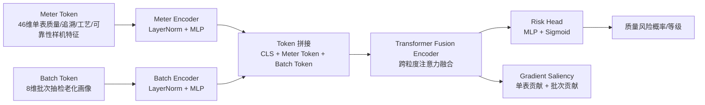

# MGQ-Former 模型构成结构

## 1. 模型定位

MGQ-Former 全称为 **Multi-Granularity Quality Fusion Transformer**，用于智能电表全生命周期质量追溯中的跨粒度多源融合。

它要解决的核心问题不是“把传统机器学习换成深度学习”，而是把三类业务粒度不同的数据放到同一个可解释风险预测框架中：

- 单表粒度：来料、出厂检测、质量链路、生产工序、AOI、维修等记录。
- 批次级工艺粒度：数字化电路板生产过程画像，例如 SMT、回流焊、在线测试、波峰焊工艺参数。
- 批次抽检粒度：每批出厂表中抽检少量样表进行老化试验，形成批次可靠性画像。

模型输出为电表质量风险概率、风险等级和关键风险因子，可用于论文中的质量风险预测、根因追溯和系统演示。

## 2. 输入特征

当前系统实现采用“两类 Token、三类证据”的输入方式。

### 2.1 Meter Token：46 维单表质量、工艺与可靠性样机特征

Meter Token 的输入维度为 46 维，由 `predict_service.FEATURE_NAMES` 固定：

- 24 维基础融合快照：来源于 `quality_feature_snapshot`，包含来料、出厂、老化退化、通信异常、生产工序、AOI、维修等单表质量特征。
- 10 维生产过程画像特征：来源于 `production_process_profile`，包含 SMT、回流焊、在线测试、波峰焊等批次级工艺参数。

需要特别说明：`quality_feature_snapshot.feature_json` 当前保存的是 24 维基础快照；模型训练矩阵在构建时会再拼接 10 维生产过程画像和 12 维 X202201001 可靠性样机生产-试验后画像，因此 MGQ-Former 的 Meter Token 实际输入为 46 维。

10 维生产过程画像特征包括：

- SMT 贴片压力/位移。
- SMT 贴片精度 CPK。
- 回流焊温区跨度。
- 回流焊传送带速度。
- 在线测试单表电流。
- 在线测试电流偏离均值。
- 在线测试最大电流。
- 波峰焊预热温区跨度。
- 波峰焊锡炉温度。
- 波峰高度差。

### 2.2 Batch Token：8 维批次抽检老化画像

Batch Token 来源于 `batch_quality_profile`，输入为 8 维批次可靠性画像：

- 抽检样本数。
- 抽检高风险率。
- 平均末期误差。
- 最大末期误差。
- 平均退化率。
- 最大时钟漂移。
- 最大 RS485 异常次数。
- 批次画像置信度。

老化试验不是每块电表都做，而是每批抽检几块表。因此 Batch Token 不能理解为某块样表对所有电表的一对一标签复制，而应理解为“该批次的可靠性背景证据”。

## 3. 网络结构



## 4. 数学描述

设 46 维单表质量、工艺与可靠性样机特征为：

```text
x_m ∈ R^46
```

设 8 维批次抽检老化画像为：

```text
x_b ∈ R^8
```

分别编码：

```text
h_m = Encoder_m(x_m)
h_b = Encoder_b(x_b)
```

构造 Transformer 输入：

```text
Z = [CLS, h_m, h_b]
```

经融合编码器得到：

```text
H = Transformer(Z)
```

最终风险概率：

```text
p = Sigmoid(MLP(H_CLS))
```

## 5. 当前 Excel 数据的使用方式

`data/raw/样品出厂检测和数字化电路板生产过程数据26.xlsx` 已被拆成两类数据使用：

- 上方出厂检测区：解析为 `factory_test` 记录。
- 下方数字化电路板生产过程区：解析为 `production_process_profile` 记录。

当前解析出的生产过程画像包括 SMT 贴片、回流焊、在线测试和波峰焊工艺参数。由于该 Excel 只提供 1 条批次级工艺画像，系统在训练矩阵构建时将其作为当前演示批次的共享工艺证据使用；这是一种合理的批次级建模方式，不是伪造每块表都有独立工艺实验数据。

## 6. 可解释输出

系统当前实现使用梯度显著性解释：

- 单表层面：解释风险主要来自生产重测、AOI、维修、误差退化、RS485、在线测试电流、回流焊和波峰焊等因素。
- 批次层面：解释风险主要来自抽检高风险率、最大末期误差、最大时钟漂移、RS485 异常等批次画像因素。

后续可继续扩展：

- Transformer attention 可视化。
- SHAP 与梯度显著性对比。
- 单表风险解释报告。
- 批次质量风险报告。
- 工艺参数敏感性分析。

## 7. 与基线模型的关系

论文实验建议设置如下对比：

- Rule-based：专家规则基线。
- LightGBM / XGBoost / RandomForest：传统机器学习强基线。
- TabNet / FT-Transformer：表格深度学习基线。
- MGQ-Former：本文提出的跨粒度深度融合模型。

核心消融实验：

- 去掉 10 维生产过程画像特征。
- 去掉 Batch Token，仅使用 46 维 Meter Token。
- 去掉 Transformer 融合，仅使用 MLP 拼接。
- 对比有无批次画像、有无生产过程画像时的风险预测效果。

## 8. 与用电异常/窃电检测模块的关系

用电异常与窃电嫌疑检测不作为 MGQ-Former 的主任务，而作为系统扩展应用。推荐论文写法是：

- 主模型 MGQ-Former 负责出厂前质量风险预测与质量追溯。
- 用电异常模块负责运行阶段辅助告警，可采用规则、Isolation Forest、AutoEncoder 或 Transformer-AE。
- 两者共享多源数据治理、风险评分、可解释报告和人工复核闭环。
- 论文权重上，质量追溯与风险预测为主，用电异常检测为扩展验证。

## 9. 当前系统实现位置

- 模型服务：`app/services/deep_fusion_service.py`
- 特征定义：`app/services/predict_service.py`
- 生产过程画像融合：`app/services/data_linkage_service.py`
- Excel 解析：`app/services/etl_service.py`
- 训练入口：`POST /train/stream?model_type=mgqformer`
- 增量训练入口：`POST /retrain/full`，请求体可传 `{"model_type": "mgqformer"}`
- 模型版本：写入 `model_version` 表，`model_type="mgqformer"`
- 模型文件：保存于 `ml_models/mgqformer_*.pkl`
- 架构接口：`GET /models/mgqformer/architecture`
