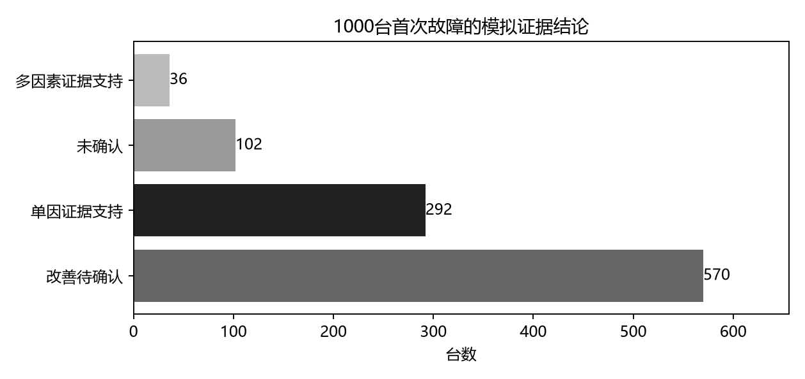
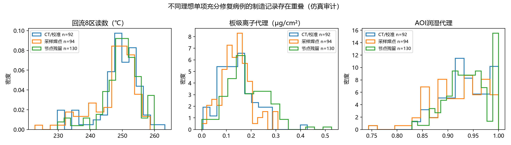

# 电表制造全链路样本 v6：生成与质量校验报告

日期：2026年11月16日。原v5文件保留，本目录为独立v6研究版本。

## 1. 本次结论

已按“元件与工艺—初次出厂检测—复测—局部检查—维修—再次复测”的顺序生成10000台电表，9000台首次通过、1000台首次故障。无加速老化，无日计时误差。

**数据结构与数值一致性50/50项通过；这不等于物理真实性或企业适用性已验证。** 以前单一工艺字段与原因几乎一一对应、所有故障一次修好的结构已取消。三类计量原因的联合输入随机森林留出宏F1为0.7190，制造信息单独输入为0.3683，单字段制造捷径为0.2339。结果不再接近100%，但制造信息在当前假设下太弱，检测前预测尚不具备实用价值。

本版可以用于研究不确定证据下的原因分析、数据接口和弱监督流程。**不能凭本版证明深度学习优于传统算法，也不能宣称已实现可靠的出厂前预测。** 没有根据模型分数重新调生成器、挑随机种子、删除难例或篡改标签。

## 2. 改动的工程逻辑

| 旧问题 | v6处理 | 保留的边界 |
| --- | --- | --- |
| 焊点故障必然伴随低炉温和低AOI | 先生成批次配方、局部温度、焊膏状态、氧化与接触裕量，再生成带误差的记录 | 设备读数正常也可局部失效；异常参数也可通过 |
| 板级离子读数直接对应残留故障 | 分离板级抽检代理、故障节点局部残留与节点敏感性 | 清洁度记录不能直接读取局部真值 |
| 每例只激活一个原因 | 每台同时生成8类机制，允许相加、抵消及跨域影响 | 模拟供电不足可同时影响计量、通信和显示 |
| 通信/显示症状直接唯一对应原因 | 通信有焊点、收发器和供电候选；显示有接触、驱动和供电候选 | 相同表象存在多个维修方向 |
| 维修成功才保留故障 | 只按初次检测分层抽样，选入后才生成复测与维修 | 不依据复测稳定性或维修成败筛病例 |
| 理想修复即确认唯一原因 | 检查有漏检/误检，维修不完全有效、可能伴随其他作用 | 保留多因素、改善待确认和未确认 |
| 生成器知道的原因直接当企业标签 | 分开保存模拟证据标签与理想处理对照审计 | 审计真值不进入生产Excel和模型输入 |

这里的观测误差和间歇性是有位置与作用对象的模拟机制，没有随机把正常标签改成故障来制造难度。

## 3. 数量与完整链条

| 项目 | 数量 | 说明 |
| --- | ---: | --- |
| 独立电表 | 10000 | sample_id不重复 |
| 首次通过 / 正样本 | 9000 | y_any_fail=0 |
| 首次故障 / 负样本 | 1000 | y_any_fail=1；修好也不改变 |
| 虚拟批次 | 500 | 每批20台 |
| 制造输入字段 | 34 | 原30列加4项来料/焊膏代理 |
| 初次检测观测 | 12 | 10个计量点、通信失败次数、显示缺段数 |
| 局部诊断检查 | 8000 | 每台初次故障8项 |
| 模拟维修 | 1488 | 最多两轮，未按成败筛选 |
| 复测 | 6464 | 维修前2000次，维修后4464次；不是新增电表 |
| 计量 / 通信 / 显示故障 | 465 / 330 / 343 | 故障域可重叠，不能相加作为台数 |
| 多故障域共现电表 | 116 | 三域同时异常22台、两域94台 |

| 划分 | 台数 | 首次故障 | 批次 |
| --- | ---: | ---: | ---: |
| train | 6400 | 640 | 320 |
| validation | 1800 | 180 | 90 |
| test | 1800 | 180 | 90 |

按虚拟批次、原始背景电表、CT和晶振来源隔离。背景电表来源为19/5/5，CT与晶振为6/2/2。没有相同34维制造向量跨划分重复。但这些批次来自同一套仿真假设，不等于企业跨时期/跨工厂外部验证。

为满足用户指定10%首次故障占比，共提议16432次，按T0结果拒绝6432次；维修结果拒绝次数为0。固定分层抽样会改变自然发生率，10%不能解释为企业不良率。批次内的故障数也是配额抽样的结果，不能用于推断真实批次产线控制能力。

### 3.1 模拟证据确认

| 结论 | 台数 | 单因监督口径 |
| --- | ---: | --- |
| 单因证据支持 | 292 | 仅这些病例可作有误差的单因证据标签 |
| 多因素证据支持 | 36 | 不压缩成一个主要原因 |
| 改善待确认 | 570 | 未指定最终单因标签 |
| 未确认 | 102 | 保留未知 |

“单因证据支持”的条件是：初次故障在两次维修前复测中原故障域均稳定复现；局部检查阳性；一次目标维修且没有记录到伴随干预；之后三次全部通过。这是模拟证据规则，不是唯一因果证明。

292个单因标签中，291个对应的理想单项处理在同次测量条件下足以恢复，仍有1例不一致。这个数字衡量仿真内部一致性，不是企业根因诊断准确率。不能把标签全都称为“拆解确认真值”。

1000台初次故障中，709台两次维修前复测均异常，90台两次均通过；641台在两次中稳定复现全部原故障域。偶发症状不会被删去。

### 3.2 原因标签覆盖

| confirmed_cause_code | 原因 | test | train | validation |
| --- | --- | --- | --- | --- |
| CT_CALIBRATION | CT特性与校准补偿不匹配 | 13 | 40 | 14 |
| LCD_CONTACT | LCD连接异常 | 5 | 18 | 3 |
| LCD_DRIVER | LCD屏体/驱动异常 | 1 | 13 | 6 |
| PCB_RESIDUE | 高阻节点残留泄漏 | 15 | 62 | 11 |
| POWER_SUPPLY | 供电裕量不足 | 4 | 5 | 4 |
| RS485_DEVICE | RS485收发器裕量不足 | 3 | 7 | 3 |
| RS485_JOINT | RS485连接异常 | 7 | 30 | 8 |
| SAMPLING_SOLDER | 采样焊点接触异常 | 3 | 12 | 5 |

总计量三类证据标签175台，其中训练114、验证30、测试31；测试采样焊点只有3台。8类单因证据292台的训练/验证/测试为187/54/51。现有单因监督样本明显偏少，尤其供电、收发器、显示驱动。不能拿10000这个总数当作“10000个已确认根因样本”。

### 3.3 生成器机制审计

理想单项处理足以恢复且仅一种单项充分处理的病例836台；存在多种可替代单项充分处理的76台；需要联合处理的88台。后两类合计164台不具有唯一单项答案。这是固定同次测量随机量下的仿真处理分析，枚举到三机制组合，不等同于实际维修实验的因果识别。

1488次维修中，669次末轮三次复测均通过，328次部分改善，491次未明显改善。50次采样焊点返修同时可能轻微清洁附近残留，明确记录为伴随干预，不能直接确认焊点独因。

9000台正常样本中1119台存在至少一个模拟风险事件，说明风险因素与故障标签并非同一件事。

## 4. 质量校验

完整逐项结果见《质量硬校验.csv》，全部50项通过，主要包括：

- 独立电表、正负数量、批次与各划分比例；表间主外键及记录唯一性。
- 由10个误差值、通信失败比例、缺段数独立重新计算首次与复测故障标签。
- 100000个工况点的背景、CT、焊点、泄漏、供电及噪声数值分解；相加舍入差不超过0.000000501个百分点。
- 通信成功率、失败计数、42段编号、复测次数及维修顺序一致。
- 单因证据条件、未知标签留空、伴随干预记录及首次标签不随维修改变。
- 同次理想处理只修改对应机制，非关联检测域保持原方程结果。
- 批次及原始来源不跨训练/验证/测试，34列白名单无未来信息，全部CSV及原始来源哈希一致。

以上是结构、数值和程序口径校验，未把“分数降低”或“深度模型胜出”列为合格标准。温度、局部残留、接触状态、噪声、检查敏感度与维修效能仍未经过企业实际记录标定。

### 4.1 参数重叠

图按生成器理想单项充分处理的三类计量病例分组，目的是检查炉温、板级离子与AOI是否仍是原因暗码。多类区间已明显重叠。详细5%—95%区间见《关键参数区间重叠.csv》。区间重叠本身不能证明模拟分布等同真实制造分布。

### 4.2 测量噪声敏感性

对同一批电表保持机制、接触激活、通信与显示随机量不变，仅把计量读数噪声从原水平倍增。30/10000台的初次标签改变，其中28台由通过变故障、2台由故障变通过，标签翻转率0.30%。这是同台配对挑战，不是额外10000台样本。它只检验计量测量噪声，未覆盖所有参数不确定性。

### 4.3 Excel交付核验

导出后以只读方式逐项对比8个数据页，合计1,059,159个单元格与生成器交付内容一致，差异为0；表头、实际行数、总览公式及缓存全部通过。构建时实际扰动一个首次标签，总览正常/故障数随之变化，再恢复为9000/1000。9个工作表已渲染检查，采用黑白灰表格。详见excel_export_quality.json。

这次检查覆盖导出文件内容、公式和渲染结果，没有声称已在微软Excel原生界面打开验收。

## 5. 简单模型是否仍能轻易识别根因

本节为探索性留出审计。模型结构和默认参数固定，没有根据测试集选择生成参数。所有制造特征标准化只用训练集；字段捷径只用验证集选择后在测试集报告。原v5与新v6样本和标签人群不同，不能把两者的分数差当成某算法的性能改进。

### 5.1 三类计量原因：以模拟维修证据标签监督

manufacturing为34项制造字段；T0_observations为12项初次检测观测；combined为两者组合。

| view | model | n | macro_f1 | accuracy |
| --- | --- | --- | --- | --- |
| manufacturing | logistic | 31 | 0.3395 | 0.4516 |
| manufacturing | tree_depth2 | 31 | 0.1376 | 0.1290 |
| manufacturing | random_forest | 31 | 0.3683 | 0.5161 |
| T0_observations | logistic | 31 | 0.6513 | 0.6452 |
| T0_observations | tree_depth2 | 31 | 0.7190 | 0.8065 |
| T0_observations | random_forest | 31 | 0.6918 | 0.8065 |
| combined | logistic | 31 | 0.3448 | 0.4839 |
| combined | tree_depth2 | 31 | 0.7422 | 0.8387 |
| combined | random_forest | 31 | 0.7190 | 0.8065 |

随机森林combined宏F1=0.7190，按测试批次重抽样的探索性2.5%—97.5%范围为0.473—0.928。测试仅31例、采样焊点3例，区间很宽。深度为2的树combined也达到0.7422，这说明目前没有证据支持“深度模型必然更好”。

制造字段单独表现较低。联合输入的逻辑回归还低于只用检测，反映小样本下加入弱制造信息可能降低泛化表现，不能把“全链路输入”自动等同于更准确的溯源。

### 5.2 最强单字段捷径

| view | chosen_feature | validation_macro_f1 | test_macro_f1 |
| --- | --- | --- | --- |
| manufacturing | reflow_zone_02_reading_sim_C | 0.3294 | 0.2339 |
| T0_observations | error_Imax_0.5L_pct | 0.4588 | 0.3437 |
| combined | error_Imax_0.5L_pct | 0.4588 | 0.3437 |

制造字段中经验证集选出的单字段树桩测试宏F1仅0.2339，已无旧版“一个炉温/离子值就识别原因”的明显捷径。单字段结果不是对所有可能组合捷径的穷尽证明。

### 5.3 生成器理想单项充分处理标签，仅用于审计

| view | model | n | macro_f1 |
| --- | --- | --- | --- |
| manufacturing | logistic | 54 | 0.3719 |
| manufacturing | tree_depth2 | 54 | 0.3220 |
| manufacturing | random_forest | 54 | 0.3867 |
| T0_observations | logistic | 54 | 0.7626 |
| T0_observations | tree_depth2 | 54 | 0.7654 |
| T0_observations | random_forest | 54 | 0.8897 |
| combined | logistic | 54 | 0.5333 |
| combined | tree_depth2 | 54 | 0.7654 |
| combined | random_forest | 54 | 0.8897 |

这一人群测试54台。随机森林制造单独0.3867，检测或联合0.8897。说明检测症状仍存在较强机制信号，这是可以解释的；不应要求所有可解释响应都模糊到不可学习。这里的理想标签不作为企业数据的根因监督文件，也不能拿它与上一人群直接比较模型优劣。

### 5.4 八类原因

8类单因证据测试仅51例。随机森林T0观测宏F1=0.6888，联合输入=0.6678，制造字段单独=0.2343。详细验证/测试结果见《八类原因探索基线.csv》。新增原因使通信与显示不再只对应一种答案，但稀有类数量仍不足以做稳定的8类深度学习比较。

## 6. 检测前预测：发现仍未解决的限制

只使用T0之前的34项制造字段，测试1800台、故障180台。

| model | n | average_precision | roc_auc | tp | fp | fn | tn |
| --- | --- | --- | --- | --- | --- | --- | --- |
| logistic | 1800 | 0.1115 | 0.5192 | 180 | 1620 | 0 | 0 |
| random_forest | 1800 | 0.1148 | 0.5245 | 165 | 1467 | 15 | 153 |

随机森林AP=0.1148，ROC-AUC=0.5245。10%故障率的随机AP基线约为0.10，AP按测试批次重抽样范围0.0898—0.1429，包含0.10。**当前版本的制造输入不足以支持有效的出厂前预警。**

上表TP/FP使用验证集最大F1阈值：弱信号加上不均衡标签导致阈值偏低，随机森林在测试中误报1467台，逻辑回归几乎全报故障。因此不能以召回率高作为可用证明。

补充按验证集分数90分位设定约10%复核容量的阈值。随机森林在测试上报272台（因分布差异，实际15.11%），其中28台故障、244台误报；精确率10.29%，召回率15.56%。换一个阈值并没有解决信息不足，也不能把控制误报量当作预测能力提升。

原因是本版让多种局部风险独立于批次级记录发生，实际故障对逐板/单件状态敏感，而现有Excel大多是来源背景、炉温设定和有限抽检代理。去掉旧版标签捷径后，这个信息缺口暴露出来。不能通过把故障真值复制进制造输入来解决。

建议下一阶段优先补充真正发生在T0之前的观测，或在明确标注假设后建立独立测量模型：

| 拟补观测 | 工程价值 | 防止泄漏的约束 |
| --- | --- | --- |
| 逐板SPI焊膏体积/高度/偏移、焊盘位置 | 关联局部润湿和连接裕量 | 不直接复制“焊点缺陷强度” |
| 实际板温曲线、峰值、液相以上时间、工位时间 | 区分炉温读数和实际板上热历程 | 企业材料/焊膏工艺窗口待确认 |
| 单件CT多点来料曲线与生产校准记录 | 判断补偿与元件特性是否失配 | 若等同最终出厂检测，须调整预测时点 |
| 清洁抽检位置、残留、绝缘与环境记录 | 判断板级代理是否覆盖敏感节点 | 检查位置、抽检比例和缺失机制要保留 |
| 装配压接力、连接尺寸、供电纹波/负载裕量 | 提供通信、显示、供电的前置质量信息 | 维修后检查不冒充制造前置观测 |

应先由企业或导师认可观测定义、测量误差与抽检覆盖，再冻结下一版生成机制。当前数据保持冻结，没有依据上述模型分数反复调参。

## 7. 数据来源与物理适用边界

沿用29台电表最初计量误差背景、10只CT交流抽检曲线与10只晶振来料背景、原始回流配方。来源是已有三份Excel，具体文件、工作表、单元格与SHA256见source_manifest.json、来源映射.csv及元件抽检来源.csv。

历史可靠性试验文件仅取“基本误差”页初始C2:AF12范围，不读后续老化轮次。晶振频差仅作元件来源元数据，不生成日计时误差，也不参与故障标签或34项模型输入。没有完整真实整机—元件—工艺—维修配对数据。

本版CT只使用原始交流前三个归一化电流锚点，采用简化插值与相位响应；高于最高锚点的响应没有额外真实标定。计量响应的电流映射、限值、通信200次/95%及42段显示假设都属于本研究模拟协议，**不是依据企业型号和检定等级确认过的标准符合性结论**。

供电、RS485与LCD来料裕量代理、焊膏活性代理、局部残留、失效概率、诊断误检漏检率及维修效能均为工程假设。没有外部文献/企业数据把这些概率标定为实际发生率。

## 8. 使用规则与迁移

1. 检测前预测用training_dataset_10000.csv，特征只读取model_contract.json的primary_features；排除ID、来源、划分、标签及T0观测。
2. 原因分析的推理时点是初次检测后、局部检查前；可用34项制造字段加12项T0观测。局部检查、复测、维修和确认结论不能作为这一时点的推理输入。
3. diagnosis_confirmed_single.csv是292例有误差的模拟证据标签；三类主研究仅175例。其余病例用未标注、弱监督、多因集合或拒识机制处理，不能补一个武断的单因。
4. 所有“仅审计”文件以及sampling_log都禁止作为正常训练或推理特征。理想单项充分处理标签只供仿真机制审计，不能混称企业确认。
5. 沿用提供的train/validation/test。此轮已探索性查看测试成绩，后续论文的最终比较应另行冻结实验协议并准备新的模拟种子留出或真实外部验证。
6. v6新增4项前置代理、8类原因与未知/多因状态，和原v5五分类模型/系统不直接兼容。部署前需要更新字段映射、标签字典及模型输入维度；本任务未替换运行系统或重新训练深度模型。

## 9. 交付内容

- Excel：生产与出厂总表10000台、故障确认、维修、复测、诊断检查、批次配方、元件原始抽检及字段说明。
- CSV：机器字段完整数据、来源映射、训练/诊断视图、全部独立审计记录。
- 脚本：generate_v6.py、validate_v6.py、audit_extended.py、build_v6.mjs及来源读取器。
- 复现：协议、固定种子、生成前哈希、来源哈希、数据哈希和依赖版本。完整压缩包可供师弟复核。

当前可确认的是：链条记录完整，模拟逻辑更丰富，结构与数值一致性通过，明显单字段根因捷径已减弱。真实制造分布、稀有原因监督规模和检测前信息充分性仍有待解决。
