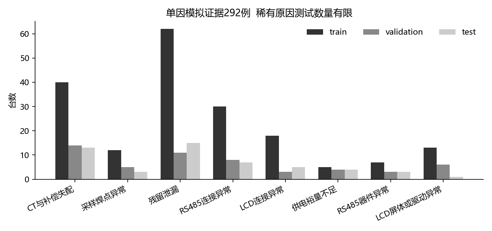
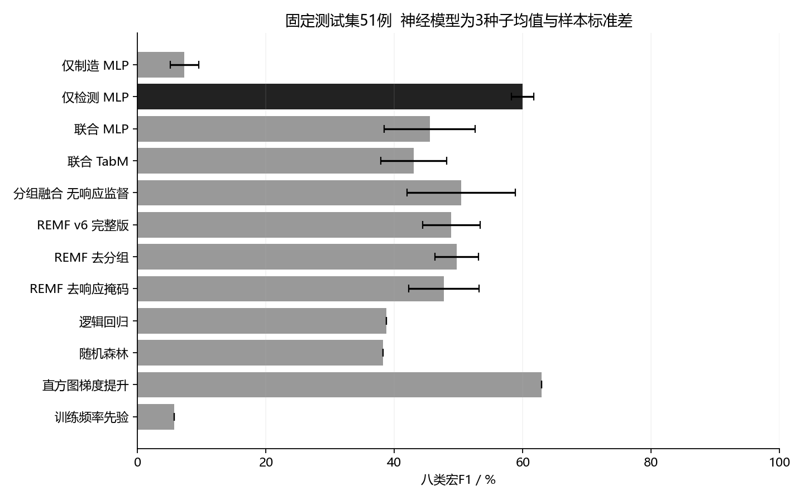
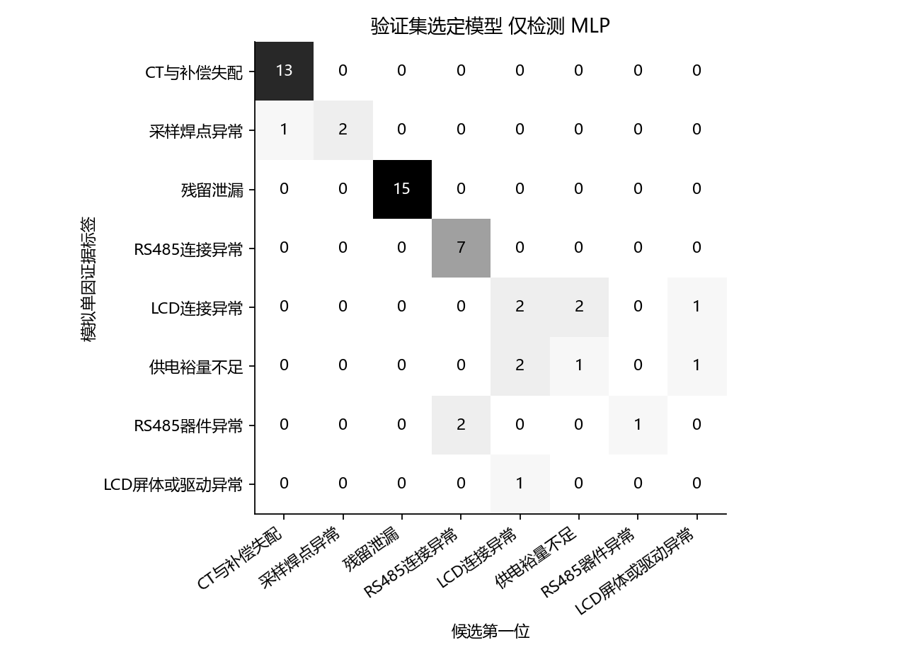
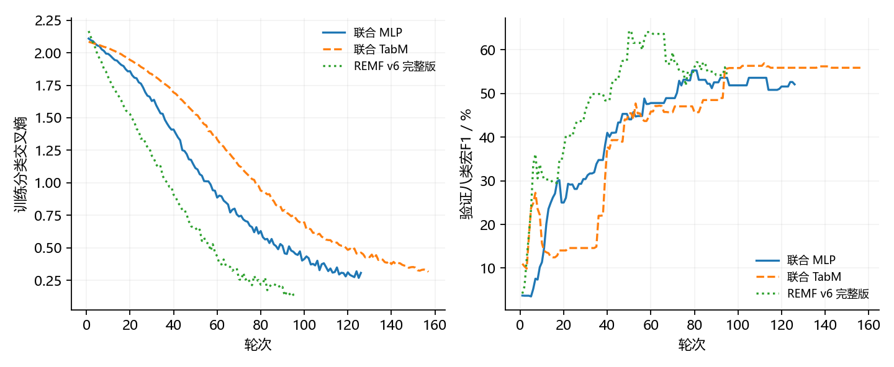
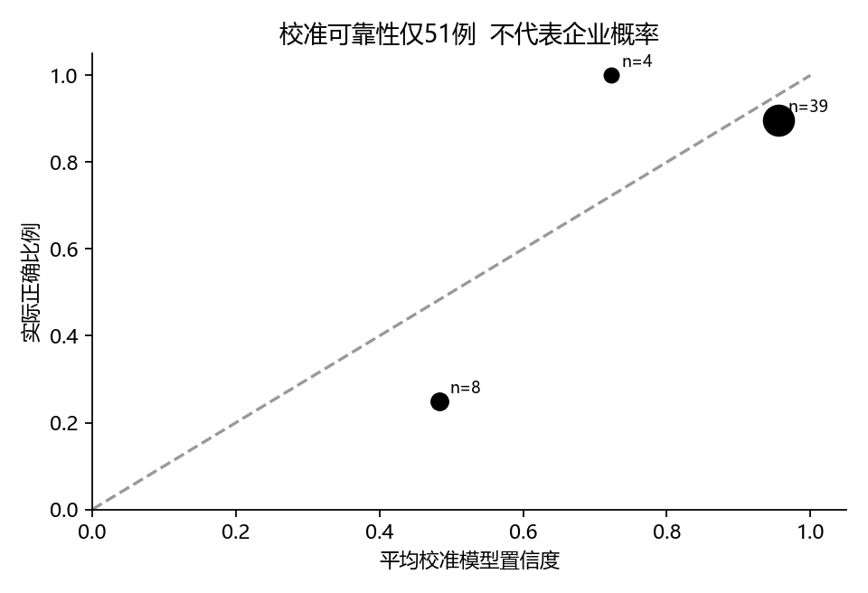

# 电表故障根因模型 GPU 训练与测试报告

实验日期 2026年11月16日

## 1 本轮结论

使用冻结v6样本完成24次GPU神经网络训练和4个CPU传统基线训练。本轮仅研究首次出厂检测异常后的根因辅助分析，不训练检测前预测，也不将数字孪生、博世电锤验证作为已完成内容。

按验证集三种子平均八类宏F1选定的模型是仅检测 MLP；选定的神经模型是仅检测 MLP。测试单因证据仅51例，选定模型集成宏F1为60.30%，Top2为92.16%，Top3为100.00%。这些是模拟证据标签上的结果，不是真实企业根因识别准确率。

选定神经模型的集成宏F1为60.30%。与随机森林的配对批次bootstrap差值区间为[1.66, 35.73]个百分点。配对区间未跨零，但仍是小规模合成留出的探索性结果，不能外推企业效果。 完整版REMF是否更好，必须同时结合消融和逐类表现判断，不能按名称预设胜出。

## 2 数据与决策时点

10000台独立电表包含9000台首次通过与1000台首次故障。根因单标签监督仅使用292台单因模拟证据病例，训练187、验证54、测试51。多因素36例、改善待确认570例、未确认102例均不强制赋予单一原因。正常样本不加入故障原因分类，训练6400台正常与故障的无标签前置观测仅用于拟合输入均值与标准差。

| 原因 | 训练 | 验证 | 测试 |
| --- | --- | --- | --- |
| CT与补偿失配 | 40 | 14 | 13 |
| 采样焊点异常 | 12 | 5 | 3 |
| 残留泄漏 | 62 | 11 | 15 |
| RS485连接异常 | 30 | 8 | 7 |
| LCD连接异常 | 18 | 3 | 5 |
| 供电裕量不足 | 5 | 4 | 4 |
| RS485器件异常 | 7 | 3 | 3 |
| LCD屏体或驱动异常 | 13 | 6 | 1 |

输入为34项制造及元件观测和12项首次检测观测。推理时点固定在首次检测后、检查复测维修之前。维修、复测、诊断检查及确认结论不作为推理输入；仅训练集首轮维修响应允许用于辅助监督。训练可用无伴随干预的首轮维修619例。后续维修受首轮处理影响，本轮不用于辅助标签。

沿用原始train/validation/test，虚拟批次、背景电表、CT及晶振来源不交叉。真实配对整机制造及维修确认记录为0；29台电表背景与有限元件抽检扩展为半合成数据，并不代表10000台实测。v6测试此前已做简单模型探索性审计，本轮新增实验冻结不等于建立了全新的外部盲测。

## 3 本机运行环境与冻结协议

实际解释器为 `D:\Users\jay\anaconda3\envs\yolov9\python.exe`，Python 3.9.18，PyTorch 2.5.1+cu121，CUDA运行时12.1，GPU为NVIDIA GeForce RTX 4060。所有24次神经训练均强制cuda:0，GPU不可用会直接报错，没有静默退回CPU。传统逻辑回归与树模型使用CPU。

神经训练最大300轮、AdamW学习率0.001、权重衰减0.01，45轮未改进早停。使用固定种子17、43、101；训练类别权重为样本频率平方根倒数。每次训练仅按验证宏F1选最佳轮次，同分按验证NLL；模型家族按三种子验证宏F1均值选定。测试预测在selection_frozen.json写出后才执行。本轮训练与基线拟合累计计时约1.3分钟，峰值CUDA张量显存78.4MiB，不含桌面与驱动开销。

GPU环境复用本机Conda yolov9，因旧科学计算库加载失败，另在包外目标目录安装科学计算依赖，以PYTHONPATH加载。没有改动旧项目CPU环境、已有质量系统或v6数据。实际包版本见environment.json与依赖清单。

## 4 方法及本轮候选创新

基线包括仅制造MLP、仅检测MLP、联合MLP、官方TabM、逻辑回归、随机森林、直方图梯度提升与训练频率先验。

REMF v6将制造字段分成热工艺与焊膏、CT、补偿、清洁、装配、来料裕量六组；按候选原因学习组表示，与首次检测表示融合进行8类排序。仅训练时，原因对应的响应分支拟合“维修前两次复测均值减首轮维修后三次均值”，按训练集尺度归一化，并对计量、通信、显示域均衡计算损失，辅助损失权重0.2。

响应掩码表达预先约定的工程关系：CT、采样焊点和残留作用于计量域，通信连接与收发器作用于通信域，LCD连接与驱动作用于显示域，供电可涉及三域。它不是模型发现的因果图；组权重也不等于因果贡献。记录维修动作的选择存在混杂，前后变化不是无偏因果效应。

候选创新是检验分组先验与实际记录维修响应能否辅助有限标签根因诊断。本轮不宣称首创、不宣称已实现严格概念瓶颈或数字孪生，也不把复杂模型默认视为更优。

## 5 根因分类与候选排序结果

| 模型 | 八类宏F1 均值±标准差 | Top1均值 | Top2均值 | Top3均值 | 集成宏F1 |
| --- | --- | --- | --- | --- | --- |
| 仅制造 MLP | 7.27 ± 2.22 | 18.30% | 32.03% | 44.44% | 8.30% |
| 仅检测 MLP | 59.97 ± 1.76 | 80.39% | 91.50% | 100.00% | 60.30% |
| 联合 MLP | 45.50 ± 7.08 | 69.93% | 89.54% | 98.04% | 45.37% |
| 联合 TabM | 43.03 ± 5.13 | 72.55% | 88.24% | 98.69% | 41.82% |
| 分组融合 无响应监督 | 50.40 ± 8.42 | 75.16% | 89.54% | 98.69% | 54.24% |
| REMF v6 完整版 | 48.88 ± 4.48 | 74.51% | 88.89% | 99.35% | 54.24% |
| REMF 去分组 | 49.69 ± 3.40 | 75.82% | 87.58% | 94.12% | 47.59% |
| REMF 去响应掩码 | 47.69 ± 5.49 | 73.86% | 90.20% | 99.35% | 50.32% |
| 逻辑回归 | 38.79 ± 0.00 | 52.94% | 84.31% | 94.12% | 38.79% |
| 随机森林 | 38.27 ± 0.00 | 66.67% | 86.27% | 98.04% | 38.27% |
| 直方图梯度提升 | 62.91 ± 0.00 | 74.51% | 88.24% | 96.08% | 62.91% |
| 训练频率先验 | 5.68 ± 0.00 | 29.41% | 54.90% | 68.63% | 5.68% |

神经模型均值与标准差基于3个独立训练种子；传统基线只有1次训练，标准差0不表示没有统计不确定性。集成先平均3个种子的类别概率，再计算指标；它与单次模型指标均值不同，不能混写。

选定模型Top1正确41/51台，即80.39%；Top3命中51/51只表示正确原因进入三个候选，并非八类根因识别率100%。其中LCD屏体或驱动异常仅1例且Top1未识别，供电与LCD连接也较弱，宏F1因此明显低于总体准确率。简单检测特征可以区分部分故障表征，但不等于已经定位真实制造原因。

本轮仅制造MLP集成宏F1为8.30%，联合MLP为45.37%，均低于仅检测模型。可能涉及标签稀缺、制造观测信号弱、组间分布变化和小样本过拟合；本实验尚不能分清各因素贡献。测试中直方图梯度提升宏F1为62.91%，高于验证选定模型，说明验证排序存在不稳定；没有据此更换已冻结的选模结果，也不宣称深度学习优于全部传统方法。

### 5.1 验证选定模型逐类表现

| 原因 | 测试例数 | 精确率 | 召回率 | F1 |
| --- | --- | --- | --- | --- |
| CT与补偿失配 | 13 | 92.86% | 100.00% | 96.30% |
| 采样焊点异常 | 3 | 100.00% | 66.67% | 80.00% |
| 残留泄漏 | 15 | 100.00% | 100.00% | 100.00% |
| RS485连接异常 | 7 | 77.78% | 100.00% | 87.50% |
| LCD连接异常 | 5 | 40.00% | 40.00% | 40.00% |
| 供电裕量不足 | 4 | 33.33% | 25.00% | 28.57% |
| RS485器件异常 | 3 | 100.00% | 33.33% | 50.00% |
| LCD屏体或驱动异常 | 1 | 0.00% | 0.00% | 0.00% |

测试单因病例来自42个虚拟批次。选定模型集成宏F1按批次重抽样2000次的2.5%至97.5%范围为[41.75%, 71.67%]。重抽样固定8类，部分重抽样没有稀有类，因此区间仅供探索性参考。模拟标签选择机制、来源规模和稀有类别不足限制了外推。

三类计量子集仅31例。附表的macro_f1_metering3是在已知属于前三类时，将8类输出限制并重新排序得到的闭集指标；并非另外训练的三分类器，也不等于端到端八类分类效果。它与上一轮专门三分类随机森林0.719不能直接作优劣比较。

## 6 消融实验及维修响应

| 设置 | 宏F1均值 | 种子标准差 百分点 | 集成宏F1 |
| --- | --- | --- | --- |
| REMF v6 完整版 | 48.88% | 4.48 | 54.24% |
| 分组融合 无响应监督 | 50.40% | 8.42 | 54.24% |
| REMF 去分组 | 49.69% | 3.40 | 47.59% |
| REMF 去响应掩码 | 47.69% | 5.49 | 50.32% |

去响应监督、去分组、去掩码均使用同一数据划分、相同种子和选轮次规则。消融不一致或小幅提升只能作趋势分析，不能据此声称稳定创新增益。没有根据测试结果修改本轮网络或样本重新训练。

完整版REMF集成宏F1为54.24%，去响应监督版本为54.24%。本轮响应监督没有改善这项分类指标；不能将辅助响应预测误差的改善直接写成根因分类创新已得到验证。当前更适合将REMF作为待验证候选方法，下一轮用新的验证数据检验，而不是增加网络复杂度追求本测试集分数。

首轮维修响应在全部可用故障测试病例上评估，不限单因标签。按实际维修目标的训练均值是简单参照；计量MAE单位为误差百分点，通信为每200次失败次数，显示为缺段数。

| 模型 | 故障域 | 例数 | 响应MAE | 训练动作均值MAE |
| --- | --- | --- | --- | --- |
| REMF v6 完整版 | metering | 95 | 0.2813 | 0.4255 |
| REMF v6 完整版 | communication | 68 | 4.9548 | 5.1659 |
| REMF v6 完整版 | display | 65 | 0.7402 | 0.8054 |
| REMF 去分组 | metering | 95 | 0.2941 | 0.4255 |
| REMF 去分组 | communication | 68 | 5.1438 | 5.1659 |
| REMF 去分组 | display | 65 | 0.6995 | 0.8054 |
| REMF 去响应掩码 | metering | 95 | 0.2857 | 0.4255 |
| REMF 去响应掩码 | communication | 68 | 4.9672 | 5.1659 |
| REMF 去响应掩码 | display | 65 | 0.7330 | 0.8054 |

响应预测只评价已记录动作，不能支持对未尝试维修的成功率承诺。如果分支比训练动作均值还差，应保留为研究辅助项，不部署维修效果数值预测。

## 7 置信度 多因与未确认病例

温度校准仅用验证NLL选择，选定模型温度为0.774。校准前测试NLL=0.4086，校准后=0.4227；ECE从0.1229变为0.1097。51例上的校准估计不稳定，模型置信度不是企业真实概率。

仅在验证集至少保留10例且经验正确率不低于80%时选择最大覆盖阈值；若不存在满足条件的阈值则全部提示证据不足。冻结阈值0.388152，验证保留54例；测试51例中保留51例，覆盖率100.00%，保留部分正确率为80.39%。验证达标不保证测试或企业达标。

测试共有180台故障，所有模型均输出Top1至Top3。对其中7台多因证据病例，选定模型Top3覆盖全部记录原因的比例为57.14%。这里只评估候选覆盖，没有训练独立多标签模型。待确认或未确认病例没有根因真值，不能计算根因准确率，也不能将低置信度拒识率称为未知识别准确率。

输入缺失压力测试随机遮盖10%和30%的46维输入，并用训练均值填补，不重训练。它只是固定测试挑战，实际推理接口默认拒绝缺字段和空值，未假定现场缺失随机发生。

| 随机缺失比例 | 八类宏F1 | Top3 |
| --- | --- | --- |
| 10.00% | 59.29% | 98.04% |
| 30.00% | 39.41% | 96.08% |

## 8 系统接口与复现交付

提供checkpoints下全部28个权重文件、preprocessing.json、固定选模与校准参数、逐台候选原因、逐种子指标、训练记录及验收结果。predict.py按字段白名单仅提取34项制造字段与12项首次观测；首次检测通过的电表不强制归因，缺字段和非有限值直接报错。

本轮只提供独立CSV推理入口，没有替换现有电表系统的运行模型。接入系统前需要更新八类字典、46维输入、校准与拒识状态，以及多因和未知病例的展示。此前v5五分类模型不能直接接收本版数据。

复现入口为run_training.ps1。所有神经权重重载已逐一检查验证预测一致；最终验收独立重算逐台概率对应的宏F1与准确率，核对数据/协议/代码/权重哈希及训练设备。详见验收结果.json。源样本请使用已交付的v6完整数据包，不在本包重复放入原始Excel。

## 9 论文表述与下一步

当前可以写：在具有参数重叠、偶发故障、维修不完全有效和不确定标签的半合成电表数据上，完成了八类候选原因诊断、传统基线与深度模型对比、分组及响应监督消融、候选排序和不确定性分析。

当前不能写：已验证真实企业根因识别率、已证明维修因果效应、已完成电表与博世电锤通用验证、数字孪生已上线，或深度学习显著优于传统方法。

下一步优先补充真实元件—工艺—检测—拆检/维修配对证据，并增加稀有原因的确认病例。跨产品通用性需要在电锤上用一致的数据结构与实验流程另行验证；数字孪生可承载产品履历与维修反馈，但不能替代真实根因证据。论文最终实验应重新冻结方案，准备新的来源或外部留出数据。
