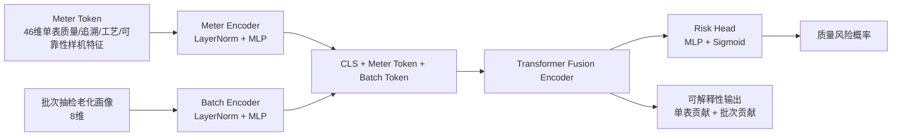

# 专业硕士大论文整理框架

## 题目建议

### 推荐题目

**面向智能电表全生命周期质量追溯的多源数据融合与可解释风险预测方法研究**

### 更偏算法题目

**基于多源数据融合的智能电表质量风险预测与根因追溯方法研究**

### 更偏工程落地题目

**智能电表全生命周期质量追溯与风险预测平台的设计与实现**

### 英文题目参考

**Multi-Source Data Fusion and Explainable Risk Prediction for Lifecycle Quality Traceability of Smart Electricity Meters**

---

## 一、论文总体定位

本论文建议按“专业硕士工程实践 + 算法应用改进”的路线组织，但研究重心必须集中在智能电表全生命周期质量追溯与可解释风险预测。

核心不是单独写某一个模型，也不是把质量预测和窃电检测并列成两个同等主题，而是围绕智能电表生产质量管控构建一条清晰主线：

- 主体研究：全生命周期多源质量数据融合、质量风险预测、根因追溯、退化分析和生产过程质量追溯。
- 扩展应用：用电异常与窃电嫌疑检测，作为系统平台的辅助功能和运行阶段应用扩展。
- 系统层：完成数据导入、文件监听、模型训练、风险预测、根因解释、异常告警、可视化分析和人工复核闭环。

建议将整篇论文的主线概括为：

> 面向智能电表全生命周期质量追溯问题，构建多源数据融合、可解释风险预测和工程化部署的一体化智能质量管控系统，并将用电异常与窃电嫌疑检测作为辅助应用验证系统扩展能力。

建议论文权重分配如下：

- 70%：全生命周期质量追溯、多源数据融合、可解释风险预测、根因追溯与退化分析。
- 15%：系统设计与工程实现。
- 10%：用电异常与窃电嫌疑检测扩展模块。
- 5%：部署测试、性能测试与应用案例。

---

## 二、论文核心研究内容

### 研究内容 1：智能电表多源异构数据建模

数据来源包括：

- 来料检测数据：晶振、互感器、关键元器件批次。
- 出厂检测数据：计量误差、时钟精度、通信模块、起动/潜动等。
- 老化试验数据：误差退化、时钟漂移、RS485 异常、正反向电量、尖峰平谷电量。
- 生产过程数据：CCD、功能测试、复校、耐压、AOI、维修记录。
- 用电异常数据：正反向电量比例、负荷曲线、时段用电结构、异常波动、疑似窃电特征。

本章重点解决数据结构不统一、字段来源复杂、业务指标难以直接建模的问题。

### 研究内容 2：质量风险预测模型

目标是在智能电表出厂前预测潜在质量风险。

可采用：

- 规则引擎作为基线。
- LightGBM、XGBoost、RandomForest 作为传统机器学习模型。
- TabNet、FT-Transformer 作为深度表格基线。
- MGQ-Former 作为本文核心方法，融合单表质量/生产特征与批次抽检老化画像。
- SHAP、梯度显著性或模型注意力作为可解释分析方法。

输出：

- 风险概率。
- 风险等级。
- 预测标签。
- 关键风险因子。
- 单表风险贡献与批次抽检风险贡献。

### 研究内容 3：质量根因追溯与退化分析

目标是回答“为什么这只电表有风险”。

可分析：

- 晶振频偏是否导致时钟漂移。
- 互感器误差是否导致计量误差。
- 老化过程中误差是否持续上升。
- 生产工序中是否存在重测、AOI 缺陷、维修记录。
- RS485 通信异常是否与后续质量风险相关。

输出：

- 全局特征重要性。
- 单表 SHAP 瀑布图。
- 老化退化曲线。
- 工序级风险解释。

### 研究内容 4：用电异常与窃电检测扩展应用

这是扩展应用章节，不建议作为论文主要创新点。它的作用是说明系统不仅能服务于出厂前质量风险管控，也能迁移到运行阶段的异常用电识别场景。

由于用电异常与窃电检测有较多公开数据集和成熟研究，论文中应降低其理论创新权重，重点写成：

- 系统应用扩展。
- 多源异常特征体系补充。
- 与质量风险模块共享的数据治理和可解释告警机制。
- 基于开源数据的辅助验证。

窃电或异常用电可表现为：

- 正反向电量比例异常。
- 负荷曲线突然下降或长期偏低。
- 尖峰平谷用电结构异常。
- 时钟漂移异常，可能影响分时计量。
- 计量误差突变或持续偏移。
- 通信异常频发，可能对应人为干扰或设备异常。
- 用电量与历史趋势、同类用户或相邻周期显著不一致。

当前项目已有基础：

- `anomaly_service.py` 已实现误差、时钟、正反向电量、尖峰平谷、电量比例、通信异常等多维检测。
- 目前方法主要是阈值规则 + Z-score 统计异常。
- 后续可增强为“规则 + 无监督异常检测 + 时序模型”的混合窃电检测框架。

建议算法路线保持简洁，不必展开成论文主算法：

- 第一层：专家规则检测，保证可解释性。
- 第二层：Isolation Forest / Local Outlier Factor / One-Class SVM 做无监督异常检测。
- 第三层：LSTM-AE / VAE / Transformer-AE 做负荷时序异常检测。
- 第四层：风险融合，将计量异常、用电行为异常、通信异常合成为窃电嫌疑评分，作为平台辅助告警结果。

输出：

- 窃电嫌疑分数。
- 异常类型。
- 异常时间点。
- 异常依据。
- 人工复核建议。

### 研究内容 5：智能分析系统设计与实现

系统功能包括：

- 数据导入与模板下载。
- 本地文件夹自动监听。
- 质量风险预测。
- 批量预测和单表预测。
- 根因追溯。
- 退化分析。
- 生产质量追溯。
- 维修分析。
- 用电异常与窃电检测。
- 消融实验。
- 模型版本管理。
- 人工复核与增量训练。

---

## 三、推荐论文目录

## 第 1 章 绪论

### 1.1 研究背景与意义

写作要点：

- 智能电表是电能计量和智能电网的重要终端。
- 电表质量问题会影响计量准确性、运维成本和供电企业管理效率。
- 窃电行为和异常用电会造成电量损失和计量争议。
- 传统检测依赖人工经验和单阶段规则，难以利用全生命周期数据。
- 因此需要构建智能电表质量风险预测与用电异常检测系统。

### 1.2 国内外研究现状

建议分为四类：

- 智能电表质量检测与故障预测研究。
- 智能电表用电异常和窃电检测研究。
- 多源数据融合与工业质量预测研究。
- 可解释机器学习与智能运维系统研究。

### 1.3 研究内容与技术路线

建议画一张总技术路线图：

```text
多源数据采集
    |
数据清洗与特征构建
    |
质量风险预测       用电异常/窃电检测
    |                    |
根因追溯与退化分析    异常评分与复核建议
    |                    |
智能电表质量管控与异常检测平台
```

### 1.4 论文组织结构

简述每章内容。

---

## 第 2 章 需求分析与总体方案设计

### 2.1 业务需求分析

从电表企业和供电管理两个角度写：

- 生产阶段需要提前识别质量风险。
- 质检阶段需要定位风险原因。
- 老化阶段需要分析性能退化趋势。
- 运行阶段需要识别异常用电和窃电嫌疑。
- 管理人员需要可视化平台和人工复核入口。

### 2.2 功能需求分析

功能模块：

- 数据管理模块。
- 质量风险预测模块。
- 根因追溯模块。
- 老化退化分析模块。
- 生产过程追溯模块。
- 用电异常与窃电检测模块。
- 模型训练与版本管理模块。
- 系统监控与文件监听模块。

### 2.3 非功能需求分析

包括：

- 本地化部署。
- 数据安全。
- 操作便捷性。
- 可解释性。
- 可扩展性。
- 响应速度。

### 2.4 系统总体架构

建议架构：

```text
数据层：SQLite / Excel / 本地监听目录
服务层：FastAPI / SQLAlchemy / 文件解析服务
算法层：质量预测 / SHAP解释 / 退化分析 / 窃电检测
展示层：Dashboard / 风险预测 / 根因追溯 / 异常检测
```

---

## 第 3 章 多源数据处理与特征工程

### 3.1 数据来源与数据结构

介绍各类数据表：

- `crystal_data`
- `ct_data`
- `factory_test`
- `aging_test`
- `quality_chain`
- `production_inspection`
- `production_process_profile`
- `meter_quality_trace`
- `aoi_defect`
- `repair_record`

### 3.2 数据清洗与标准化

包括：

- 缺失值处理。
- 异常字段处理。
- 时间字段统一。
- 条形码、表号、批次号映射。
- 数据去重和格式转换。

### 3.3 质量风险特征构建

特征分组：

- 来料特征。
- 出厂检测特征。
- 老化退化特征。
- 通信异常特征。
- 生产过程特征。

### 3.4 用电异常与窃电检测特征构建

建议重点写这一节。

特征包括：

- 日用电量、周期累计电量。
- 正向电量、反向电量及其比例。
- 尖峰平谷用电比例。
- 用电量环比变化率。
- 负荷曲线波动系数。
- 夜间/低谷异常用电特征。
- 时钟漂移与分时计量异常特征。
- 通信异常次数。
- 计量误差变化率。

### 3.5 数据集构建与标签生成

质量标签：

- 正常。
- 高风险。
- 故障。
- 维修。

窃电/异常标签：

- 正常用电。
- 计量异常。
- 疑似窃电。
- 通信异常。
- 需要人工复核。

如果真实窃电标签不足，可以采用：

- 专家规则弱标签。
- 历史稽查记录。
- 人工复核标签。
- 半监督或无监督异常检测。

---

## 第 4 章 智能电表质量风险预测方法

### 4.1 问题定义与跨粒度数据建模

输入多源质量特征，输出电表质量风险概率。需要特别说明：生产过程、出厂检测和维修记录通常是单表粒度；老化试验不是每块表都做，而是每批抽检若干块表，因此老化数据应被建模为批次级可靠性证据，不能强行作为每块生产表的一对一标签。

本章可将输入拆分为两类 Token、三类业务证据：

- Meter Token：由 24 维基础质量链路快照、10 维数字化电路板生产过程画像和 12 维 X202201001 可靠性样机生产-试验后画像组成，合计 46 维，用于描述单表质量状态、批次级工艺背景及样机级可靠性证据。
- Batch Token：由抽检老化样本聚合形成的 8 维批次质量画像，例如抽检高风险率、平均末期误差、最大时钟漂移和 RS485 异常。
- 工艺证据：`production_process_profile` 表中的 SMT、回流焊、在线测试、波峰焊参数应作为批次级工艺画像使用，不能伪装成每块电表都独立完成了完整工艺实验。

### 4.2 基于规则的质量风险评估

作为可解释基线：

- 晶振频偏阈值。
- 互感器误差阈值。
- 末期误差阈值。
- 时钟漂移阈值。
- RS485 异常阈值。

### 4.3 传统机器学习与表格深度学习基线

用于证明本文方法不是只依赖单一模型：

- RandomForest。
- XGBoost。
- LightGBM。
- TabNet。
- FT-Transformer，可作为可选深度表格对照。

### 4.4 本文方法：MGQ-Former 跨粒度深度融合网络

MGQ-Former 将 46 维单表质量/追溯/工艺/可靠性样机特征编码为 Meter Token，将 8 维批次抽检老化画像编码为 Batch Token，再引入 CLS Token，通过 Transformer Encoder 学习单表风险、批次工艺证据与批次可靠性之间的关联。

核心公式可写为：

```text
h_m = Encoder_m(x_m)
h_b = Encoder_b(x_b)
Z = [CLS, h_m, h_b]
H = Transformer(Z)
p = Sigmoid(MLP(H_CLS))
```

其中 `x_m` 为 46 维单表质量/追溯/工艺/可靠性样机特征，包含 24 维 `quality_feature_snapshot` 基础快照、10 维 `production_process_profile` 工艺画像和 12 维 `reliability_sample_profile` 样机画像；`x_b` 为 8 维批次抽检画像特征，`p` 为质量风险概率。

### 4.5 类别不平衡处理与小样本约束

包括：

- 类别权重。
- SMOTE。
- 阈值移动。
- PR-AUC 指标。
- 小样本条件下的分层验证、留一验证或 Bootstrap 置信区间。

注意：论文中要强调重采样只能在训练集内部完成，不能先 SMOTE 再划分测试集。当前系统演示数据量较小，不能把演示 AUC 作为最终论文结论，正式论文应使用更多真实批次数据或补充公开数据做稳健性验证。

### 4.6 模型可解释性分析

包括：

- SHAP 全局解释，用于传统机器学习基线。
- 梯度显著性，用于 MGQ-Former 的单表特征贡献和批次特征贡献解释。
- Attention 可视化，用于展示 Meter Token 与 Batch Token 的融合关系。
- 单表风险解释报告。
- 批次质量风险解释报告。
- 根因文本报告。

---

## 第 5 章 老化退化与质量根因追溯分析

### 5.1 老化试验数据建模

介绍老化过程中：

- 误差随时间变化。
- 时钟漂移随时间变化。
- RS485 通信异常。
- 电量结构变化。

### 5.2 退化趋势分析方法

可采用：

- 线性拟合退化斜率。
- 趋势检测。
- 阈值越限检测。
- 时间序列可视化。

### 5.3 根因追溯方法

结合：

- SHAP 解释。
- 生产过程记录。
- AOI 缺陷。
- 维修记录。
- 退化曲线。

### 5.4 案例分析

选 2-3 只电表写案例：

- 晶振异常导致时钟漂移。
- 老化误差持续上升导致高风险。
- 生产过程多次重测或维修导致质量风险。

---

## 第 6 章 用电异常与窃电嫌疑检测扩展应用

本章作为扩展应用章节，篇幅和创新权重应低于第 3、4、5 章。写作目标不是提出全新的窃电检测算法，而是说明本文构建的多源数据处理、风险评分和可解释告警框架可以扩展到运行阶段的用电异常检测任务。

### 6.1 窃电与用电异常问题定义

定义：

- 用电异常：用电行为、计量特征或通信状态显著偏离正常模式。
- 窃电嫌疑：由异常用电、反向电量、计量异常、通信异常等共同指示的高风险状态。

### 6.2 窃电异常特征体系

特征分为四类：

- 计量类特征：基本误差、误差变差、正反向电量比例。
- 时钟类特征：时钟偏差、日误差、分时计量异常。
- 用电行为特征：用电量突降、尖峰平谷比例异常、负荷曲线波动。
- 通信类特征：RS485 异常、数据缺失、采集失败。

### 6.3 基于规则与统计的异常检测

对应当前项目已有实现：

- 阈值判断。
- Z-score 异常检测。
- 3σ 统计阈值。
- 多维异常评分。

可写成：

```text
Score = w1 * 计量异常 + w2 * 电量结构异常 + w3 * 时钟异常 + w4 * 通信异常
```

### 6.4 基于开源数据的无监督异常检测验证

可利用开源用电数据集进行辅助验证。建议选择 1-2 个公开数据集即可，不必把实验做得过重。

候选方法：

- Isolation Forest。
- Local Outlier Factor。
- One-Class SVM。
- AutoEncoder。

### 6.5 基于时序模型的用电异常检测补充

如果有连续用电曲线或开源负荷序列，可作为补充实验采用：

- LSTM AutoEncoder。
- GRU AutoEncoder。
- Transformer AutoEncoder。
- VAE。

如果暂时没有足够真实运行负荷曲线，可以将本节作为扩展方法，并在实验中用开源数据或已有老化电量序列做辅助验证。注意不要让这一节喧宾夺主。

### 6.6 窃电嫌疑融合判别

建议设计一个可解释的融合框架：

```text
计量异常分数
时钟异常分数
电量结构异常分数
通信异常分数
历史趋势异常分数
        |
    加权融合 / LightGBM
        |
窃电嫌疑评分
```

输出等级：

- 正常。
- 轻度异常。
- 中度异常。
- 高度疑似窃电。
- 建议人工复核。

### 6.7 窃电检测案例分析

建议准备 1-2 个案例即可：

- 正反向电量比例异常案例。
- 尖峰平谷结构异常案例。
- 通信异常伴随电量突降案例。

---

## 第 7 章 系统设计与实现

### 7.1 系统开发环境

包括：

- Python。
- FastAPI。
- SQLAlchemy。
- SQLite。
- Jinja2。
- Bootstrap。
- ECharts。
- scikit-learn。
- LightGBM / XGBoost / pytorch-tabnet。

### 7.2 数据库设计

介绍核心表：

- 来料检测表。
- 出厂检测表。
- 老化试验表。
- 质量链路表。
- 生产过程表。
- 生产过程画像表。
- AOI 缺陷表。
- 维修记录表。
- 模型版本表。
- 数据审查表。

### 7.3 后端接口设计

包括：

- 全流程数据管理接口：按数据集统一提供查询、新增、编辑、删除能力。
- 数据集 Schema 接口：前端根据数据库字段动态生成录入表单。
- 数据链路重建接口：操作人员维护源数据后，可重建身份映射、批次画像和融合特征快照。
- 模型训练与预测接口。
- 人工复核与增量训练接口。

### 7.4 企业操作人员数据录入流程

建议作为系统实现章节的重点之一，说明本系统不只依赖 Excel 批量导入，还支持数据库驱动的逐条录入和维护。

操作流程可写为：

```text
操作人员登录系统
    |
进入“全流程数据管理”
    |
选择业务数据集
    |
逐条新增/编辑/删除来料、出厂、老化、生产、AOI、维修等数据
    |
系统进行字段类型、必填项、唯一性约束校验
    |
重建质量链路与批次抽检画像
    |
进入风险预测、根因追溯、退化分析和模型训练流程
```

该模块对应的工程实现：

- 页面：`templates/data_management.html`。
- 路由：`app/routers/data_management.py`。
- 数据表：覆盖 `crystal_data`、`ct_data`、`factory_test`、`aging_test`、`production_inspection`、`production_process_profile`、`aoi_defect`、`repair_record`、`meter_identity`、`quality_chain`、`batch_quality_profile`、`quality_feature_snapshot` 等。

### 7.5 数据库闭环管理设计

企业实际部署时建议采用如下闭环：

- 源数据录入：操作人员逐条维护原始业务记录。
- 数据质量校验：系统检查必填字段、数据类型、唯一键和条码/批次一致性。
- 链路融合：系统基于条码、订单号、批次号和抽检老化数据形成可追溯链路。
- 建模快照：系统生成固定口径的 24 维 `quality_feature_snapshot`，训练时再拼接 10 维 `production_process_profile` 和 12 维 `reliability_sample_profile`，形成 46 维 Meter Token，用于模型训练和复现实验。
- 人工复核：预测结果进入人工复核闭环，复核结果可进入后续训练。

- `/dashboard`
- `/import`
- `/predict`
- `/rootcause`
- `/degradation`
- `/anomaly`
- `/production`
- `/repair-analysis`
- `/ablation`
- `/data-review`

### 7.4 前端功能实现

介绍：

- 质量看板。
- 数据导入。
- 风险预测。
- 根因追溯。
- 退化分析。
- 用电异常检测。
- 生产追溯。
- 消融实验。

### 7.5 模型训练与版本管理

包括：

- 模型训练流程。
- 模型保存。
- 模型激活。
- 批量预测。
- 人工反馈。
- 增量更新。

---

## 第 8 章 实验结果与系统测试

### 8.1 实验数据说明

说明：

- 数据来源。
- 样本数量。
- 标签分布。
- 训练集/测试集划分。
- 异常样本构造或标注方式。

### 8.2 质量风险预测实验

对比模型：

- Rule-based。
- RandomForest。
- XGBoost。
- LightGBM。
- TabNet。

评价指标：

- Accuracy。
- Precision。
- Recall。
- F1。
- ROC-AUC。
- PR-AUC。

### 8.3 特征消融实验

实验分组：

- 仅来料特征。
- 来料 + 老化特征。
- 来料 + 老化 + 生产过程特征。
- 仅生产过程特征。
- 全特征。

### 8.4 根因追溯实验

展示：

- SHAP 全局重要性。
- 单表解释案例。
- 与维修记录或专家判断的一致性。

### 8.5 用电异常与窃电检测扩展实验

对比方法：

- 阈值规则。
- Z-score。
- Isolation Forest。
- One-Class SVM。
- AutoEncoder。
- 融合评分方法。

评价指标：

- Precision。
- Recall。
- F1。
- AUC。
- 异常检出率。
- 误报率。
- 人工复核命中率。

该部分作为扩展实验，建议控制篇幅。由于开源数据相对充足，可以采用公开数据验证异常检测模块，但不应让其成为全文主实验。

如果真实窃电标签不足，可以写：

- 基于规则弱标签的初步验证。
- 基于专家复核的案例验证。
- 基于模拟异常注入的补充实验。

### 8.6 系统功能测试

测试：

- 登录功能。
- 数据导入。
- 模型训练。
- 批量预测。
- 根因追溯。
- 异常检测。
- 文件监听。
- 页面响应速度。

### 8.7 系统性能测试

包括：

- 页面响应时间。
- 批量预测耗时。
- 模型训练耗时。
- 文件解析耗时。

---

## 第 9 章 总结与展望

### 9.1 工作总结

总结：

- 构建了智能电表多源数据管理体系。
- 实现了质量风险预测模型。
- 实现了根因追溯和退化分析。
- 扩展了用电异常和窃电检测模块。
- 完成了可部署的软件系统。

### 9.2 创新点总结

建议写三点：

- 构建了面向智能电表全生命周期的多源质量数据融合框架。
- 提出了质量风险预测与根因追溯结合的分析方法。
- 设计了面向计量、时钟、电量结构和通信状态的窃电异常检测方法。

### 9.3 不足与展望

可以诚实写：

- 真实窃电标签不足。
- 部分生产数据关联关系仍需完善。
- 深度时序模型需要更多连续负荷数据验证。
- 后续可接入更多现场运行数据和台区拓扑数据。
- 后续可迁移至 PostgreSQL 并支持多用户并发。

---

## 四、论文技术路线图

```text
                智能电表多源数据
                         |
      ------------------------------------------------
      |              |               |               |
   来料检测       生产过程         老化试验        用电运行
      |              |               |               |
      ------------------------------------------------
                         |
                  数据清洗与特征工程
                         |
      ------------------------------------------------
      |                                              |
  质量风险预测                                  用电异常/窃电检测
      |                                              |
 LightGBM/TabNet/SHAP                   规则/Z-score/Isolation Forest/AE
      |                                              |
 根因追溯 + 退化分析                         异常评分 + 复核建议
      |                                              |
      ------------------------------------------------
                         |
             智能电表质量管控与异常检测系统
```

---

## 五、建议的章节篇幅分配

| 章节 | 建议页数 |
|---|---:|
| 第 1 章 绪论 | 8-12 页 |
| 第 2 章 需求分析与总体设计 | 10-15 页 |
| 第 3 章 数据处理与特征工程 | 12-18 页 |
| 第 4 章 质量风险预测方法 | 18-24 页 |
| 第 5 章 根因追溯与退化分析 | 14-18 页 |
| 第 6 章 用电异常与窃电检测扩展应用 | 8-12 页 |
| 第 7 章 系统设计与实现 | 15-25 页 |
| 第 8 章 实验与测试 | 15-25 页 |
| 第 9 章 总结与展望 | 3-5 页 |

总篇幅建议：90-130 页。

---

## 六、当前项目需要补强的地方

### 必须补强

- 打通生产数据与质量链路数据。
- 适度增加窃电检测特征和页面表述，但保持辅助模块定位。
- 将“用电异常检测”升级为“用电异常与窃电嫌疑检测扩展应用”。
- 增加至少一种无监督异常检测算法，用于系统扩展验证。
- 增加实验对比和评价指标。
- 补充真实或模拟窃电样本。

### 建议补强

- 增加异常类型分类。
- 增加人工复核闭环。
- 增加异常案例报告导出。
- 增加模型校准和风险等级解释。
- 增加系统测试报告。

---

## 七、答辩时的推荐表述

可以这样概括本论文：

> 本文以智能电表全生命周期质量追溯为核心研究对象，设计并实现了一套多源数据融合与可解释风险预测系统。系统融合来料、出厂、老化、生产过程和维修数据，构建质量风险预测模型，实现根因追溯和退化分析。作为系统扩展应用，本文进一步引入用电异常与窃电嫌疑检测模块，基于计量误差、时钟漂移、电量结构和通信状态进行辅助告警。实验与系统测试表明，所设计方法能够支撑智能电表质量风险识别、原因定位和工程化应用。

---

## 八、一句话主线

这篇专硕大论文可以形成一个完整闭环：

> 以全生命周期质量追溯和可解释风险预测为主线，以用电异常与窃电嫌疑检测为扩展应用，用多源数据融合和工程系统实现串成一篇完整的专业硕士论文。

---

## 九、深度学习创新补充：MGQ-Former 跨粒度多源融合模型

为避免论文停留在传统机器学习模型层面，建议将核心算法升级为 **MGQ-Former（Multi-Granularity Quality Fusion Transformer）**。该模型面向智能电表质量追溯中的真实业务特点：部分生产与检测数据是单表粒度，数字化电路板工艺参数是批次级工艺画像，老化实验是批次抽检粒度，三者不能简单一对一拼接。

### 9.1 模型创新点

- 提出跨粒度多源融合思想，将单表生产质量风险、批次级电路板工艺证据与批次抽检老化风险联合建模。
- 使用单表特征编码器处理 46 维质量/生产/追溯/工艺/可靠性样机特征。
- 将 24 维基础质量快照与 10 维生产过程画像拼接为 Meter Token，避免把批次级工艺数据错误写成每块表独立实验。
- 使用批次画像编码器处理抽检老化形成的批次可靠性特征。
- 使用 Transformer 融合层学习单表 Token 与批次 Token 之间的风险关联。
- 使用梯度显著性或注意力权重解释风险来源，区分单表工序异常和批次可靠性异常。

### 9.2 模型结构



### 9.3 建议写入第 4 章的方法部分

第 4 章可由原来的“机器学习风险预测模型”升级为：

- 4.1 问题定义与跨粒度数据建模。
- 4.2 专家规则与传统机器学习基线。
- 4.3 表格深度学习基线：TabNet / FT-Transformer。
- 4.4 本文方法：MGQ-Former 跨粒度深度融合网络。
- 4.5 模型训练、类别不平衡处理与小样本增强。
- 4.6 可解释性分析：SHAP、注意力权重与梯度显著性。

### 9.4 建议实验设计

- 对比模型：Rule、RandomForest、LightGBM、TabNet、MGQ-Former。
- 消融实验：去掉 10 维生产过程画像特征、去掉批次抽检 Token、去掉 Transformer 融合层。
- 指标：ROC-AUC、PR-AUC、F1、Recall、Brier Score、ECE。
- 解释性实验：对比模型认为的关键风险因素是否与 AOI、维修、老化异常、RS485 异常一致。

### 9.5 当前系统实现

系统中已实现轻量版 MGQ-Former：

- `app/services/deep_fusion_service.py`：模型结构、训练、预测包装器。
- `model_type="mgqformer"`：作为本文深度融合主模型。
- `production_process_profile`：数字化电路板生产过程画像输入。
- `batch_quality_profile`：批次抽检质量画像输入。
- `quality_feature_snapshot`：24 维基础质量链路快照输入。
- `predict_service.FEATURE_NAMES`：定义 46 维 Meter Token 特征顺序。
- `MGQ-Former模型结构.md`：模型结构说明与图示。

### 9.6 可引用的相关研究与模型依据

建议在论文“国内外研究现状”和“方法设计”中这样组织文献：

- TabNet：作为可解释表格深度学习代表，强调 sequential attention 和特征选择能力，但在本文中仅作为深度基线。
- FT-Transformer：作为 Transformer 在表格数据上的代表性方法，用于说明表格特征 token 化和注意力融合的可行性。
- SAINT：作为行列注意力与对比预训练路线，支撑“小样本、标签不足时可考虑自监督预训练”的讨论。
- Hugging Face TimeSeriesTransformer / PatchTST：不建议直接作为质量追溯主模型，但适合用于用电异常与窃电检测中的负荷时序建模。
- 窃电检测研究：近期大量工作采用 AutoEncoder、CNN/LSTM、Transformer、半监督和 one-class anomaly detection，说明“用电异常检测”可以作为系统扩展，但不宜抢占本文主创新。

参考入口：

- TabNet: https://arxiv.org/abs/1908.07442
- FT-Transformer: https://arxiv.org/abs/2106.11959
- SAINT: https://arxiv.org/abs/2106.01342
- Hugging Face TimeSeriesTransformer: https://huggingface.co/docs/transformers/model_doc/time_series_transformer
- SGCC 窃电检测公开数据常用版本: https://www.kaggle.com/datasets/bensalem14/sgcc-dataset

### 9.7 答辩时建议强调的三句话

- 本文不是简单把 LightGBM 换成深度学习，而是针对“单表生产数据、批次级工艺画像和批次抽检老化数据”粒度不一致的问题设计跨粒度融合模型。
- 老化试验是抽检证据，因此本文采用批次质量画像建模，避免错误地把抽检样表标签复制到每块电表。
- 用电异常与窃电嫌疑检测作为运行阶段扩展应用，使用公开数据和时序异常检测方法辅助验证系统可扩展性，但论文主创新仍是质量追溯与可解释风险预测。
