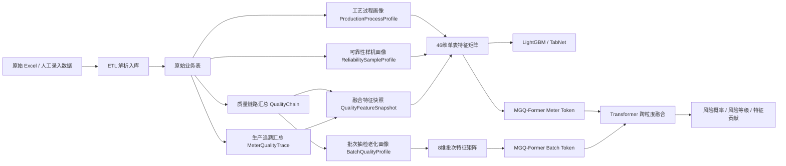

# 当前系统数据链路与算法融合说明

## 一、总体链路

当前系统的数据链路可以概括为：



一句话说明：

> 系统先把不同 Excel 和录入数据解析为数据库原始表，再按“单表质量链路”和“批次抽检质量画像”两条线生成特征，最终融合为 46 维单表特征 + 8 维批次特征，输入 MGQ-Former、TabNet、LightGBM 等模型。

## 二、当前实际接入的数据

### 1. 来料检测数据

| 数据 | 来源 | 入库表 | 当前数量 | 进入算法的字段 |
|---|---|---|---:|---|
| 晶振检测数据 | `03_晶振检测测试数据.xlsx` / `晶振和互感器10个样品的检验数据26.3.11.xlsx` | `crystal_data` | 16 | `crystal_ppm` |
| 互感器检测数据 | `04_互感器检测测试数据.xlsx` / `晶振和互感器10个样品的检验数据26.3.11.xlsx` | `ct_data` | 16 | `ct_ratio_err` |

作用：

- 用于描述核心元器件来料质量。
- 在模型中作为早期质量风险源。
- 对应论文中的“来料质量特征”。

### 2. 出厂检测数据

| 数据 | 来源 | 入库表 | 当前数量 | 进入算法的字段 |
|---|---|---|---:|---|
| 出厂检测测试数据 | `08_出厂检测测试数据.xlsx` / `样品出厂检测和数字化电路板生产过程数据26.xlsx` | `factory_test` | 16 | `clock_accuracy_sd`、`factory_fault`，以及来料批次关联字段 |

作用：

- 提供出厂阶段的检测结果。
- 可与生产条码数据按标准化条码关联。
- 当前系统通过 `meter_id / barcode` 进行标准化映射。

### 3. 1000h 老化试验数据

| 数据 | 来源 | 入库表 | 当前数量 | 进入算法的字段 |
|---|---|---|---:|---|
| 1000h 老化测试数据 | `09_1000h老化测试数据.xlsx` / `单相表-20版正面布局的耐久性（可靠性）试验数据26.3.6.xlsx` | `aging_test` | 180 | 误差、时钟、日计时、电量、RS485、误差变差、一致性等 |

进入算法的主要字段：

- `initial_error_max`
- `final_error_max`
- `error_degradation_rate`
- `clock_drift_rate`
- `clock_daily_error_max`
- `error_variability_max`
- `error_consistency_max`
- `energy_balance_ratio`
- `energy_peak_ratio`
- `rs485_total_errors`

作用：

- 是当前质量标签和质量链路的主要来源。
- 用于生成 `QualityChain`。
- 用于生成批次抽检老化画像 `BatchQualityProfile`。
- 用于异常检测页面中的误差趋势、时钟趋势、电量异常、通信异常等。

重要说明：

> 老化试验不是每块表都做，而是每批表中抽检样机。因此系统不把老化样机强行映射到每块生产表，而是将其作为批次级质量证据。

### 4. 生产过程追溯数据

| 数据 | 入库表 | 当前数量 | 进入算法的字段 |
|---|---|---:|---|
| 工序检测记录，包括 CCD、耐压、功能测试、复校等 | `production_inspection` | 6 | 重试次数、漏电流、工序通过情况 |
| AOI 缺陷记录 | `aoi_defect` | 1 | SMT AOI 缺陷、波峰焊 AOI 缺陷 |
| 维修记录 | `repair_record` | 1 | 是否维修、维修次数、故障工序 |
| 单板测试明细 | `board_test_detail` | 0 | 当前无有效记录 |
| 每块表生产追溯汇总 | `meter_quality_trace` | 6 | 生产质量综合特征 |

进入算法的生产追溯字段为：

- `prod_ccd_retry`
- `prod_func_retry`
- `prod_reverify_retry`
- `prod_total_retry`
- `prod_smt_aoi_defect`
- `prod_wave_aoi_defect`
- `prod_repaired`
- `prod_repair_count`
- `prod_leak_current_max`
- `prod_quality_risk_score`

作用：

- 用于描述每块电表在生产过程中的异常痕迹。
- 如果能与 `factory_test.meter_id` 或 `meter_quality_trace.barcode` 对上，就作为单表级生产追溯特征进入 `QualityFeatureSnapshot`。

当前情况：

- 当前数据库中生产追溯真实映射约 6 条。
- 因为生产条码与老化样机编号不是完全一一对应，所以系统没有伪造强关联。
- 生产追溯数据在论文中应说明为“已建立链路，当前受限于真实条码对应数量”。

### 5. 数字化电路板工艺过程画像

| 数据 | 来源 | 入库表 | 当前数量 | 进入算法的字段 |
|---|---|---|---:|---|
| 出厂检测工作簿中嵌入的电路板生产过程参数 | `样品出厂检测和数字化电路板生产过程数据26.xlsx` | `production_process_profile` | 1 | SMT、回流焊、在线测试、波峰焊等工艺画像 |

进入算法的 10 个工艺过程字段为：

- `process_smt_pressure_mm`
- `process_smt_precision_cpk`
- `process_reflow_temp_span_c`
- `process_reflow_conveyor_speed_cm_min`
- `process_online_current_meter_ua`
- `process_online_current_deviation_ua`
- `process_online_current_max_ua`
- `process_wave_preheat_span_c`
- `process_wave_solder_temp_c`
- `process_wave_peak_height_delta_mm`

作用：

- 描述该批次或文件对应生产工艺状态。
- 当前只有一个工艺画像时，系统将其作为批次级工艺证据，补充到每条训练样本。
- 这部分是“生产数据进入算法”的重要路径之一。

### 6. 可靠性样机生产数据与试验后数据

| 数据 | 来源 | 入库表 | 当前数量 | 进入算法的字段 |
|---|---|---|---:|---|
| 生产数据-X202201001可靠性样机误差数据 | 微信文件路径中的 `3、生产数据-X202201001可靠性样机误差数据.xls` | `reliability_sample_production_record` | 51629 | 生产误差统计、不合格率、测试日期数 |
| 试验后数据-X202201001可靠性样机误差数据分析 | 微信文件路径中的 `4、试验后数据-X202201001可靠性样机误差数据分析.xls` | `reliability_sample_after_record` | 630 | 试验后误差、试验前后偏移、日计时误差 |
| 聚合后的可靠性样机画像 | 由上述两表构建 | `reliability_sample_profile` | 389 | 12 维可靠性画像 |

进入算法的 12 个可靠性画像字段为：

- `rel_prod_error_abs_max`
- `rel_prod_error_abs_avg`
- `rel_prod_error_abs_std`
- `rel_prod_bad_rate`
- `rel_prod_test_date_count`
- `rel_after_error_abs_max`
- `rel_after_error_abs_avg`
- `rel_after_deviation_abs_max`
- `rel_after_deviation_abs_avg`
- `rel_timing_after_abs`
- `rel_risk_score`
- `rel_sample_count`

作用：

- 这两个 Excel 已经接入系统。
- 系统将其从样机明细聚合为可靠性样机画像。
- 由于当前可靠性样机与主训练样本缺少可信的一一对应条码桥，系统采用“批次/总体可靠性画像均值”作为弱质量证据输入算法。

论文中可以这样解释：

> 可靠性样机数据用于补充产品在试验前后误差稳定性和日计时稳定性方面的先验质量证据。由于当前数据缺少与每块生产表之间的可信条码映射，本文将其构造为批次级或总体可靠性画像特征，而非直接作为单表标签。

### 7. 人工录入数据

当前系统支持通过数据管理页面逐条录入和管理：

- 来料数据
- 生产过程数据
- 出厂检测数据
- 老化/质量链路相关数据
- 追溯链路数据

作用：

- 面向企业现场操作人员。
- 用于补充 Excel 缺失数据。
- 后续可以进入同一套数据库表，再通过 `QualityFeatureSnapshot` 进入算法。

## 三、当前数据库中的数据规模

| 数据表 | 当前数量 | 含义 |
|---|---:|---|
| `quality_feature_snapshot` | 232 | 最终进入算法的融合训练快照 |
| `quality_chain` | 232 | 每块电表的质量链路汇总 |
| `aging_test` | 180 | 老化试验时序记录 |
| `batch_quality_profile` | 1 | 批次抽检老化画像 |
| `factory_test` | 16 | 出厂检测记录 |
| `crystal_data` | 16 | 晶振来料记录 |
| `ct_data` | 16 | 互感器来料记录 |
| `production_inspection` | 6 | 生产工序检测记录 |
| `meter_quality_trace` | 6 | 单表生产追溯汇总 |
| `production_process_profile` | 1 | 工艺过程画像 |
| `aoi_defect` | 1 | AOI 缺陷记录 |
| `repair_record` | 1 | 维修记录 |
| `reliability_sample_production_record` | 51629 | 可靠性样机生产误差明细 |
| `reliability_sample_after_record` | 630 | 可靠性样机试验后数据 |
| `reliability_sample_profile` | 389 | 可靠性样机聚合画像 |
| `meter_identity` | 6 | 生产条码映射 |

## 四、最终进入算法的特征

当前风险预测模型的主输入是 46 维单表特征。

### 1. 基础质量链路特征，24 维

来自 `QualityFeatureSnapshot`，包括：

| 类别 | 特征 |
|---|---|
| 来料/出厂 | `crystal_ppm`、`ct_ratio_err`、`clock_accuracy_sd`、`factory_fault` |
| 老化误差 | `initial_error_max`、`final_error_max`、`error_degradation_rate` |
| 时钟与日计时 | `clock_drift_rate`、`clock_daily_error_max` |
| 稳定性 | `error_variability_max`、`error_consistency_max` |
| 电量结构 | `energy_balance_ratio`、`energy_peak_ratio` |
| 通信异常 | `rs485_total_errors` |
| 生产追溯 | `prod_ccd_retry`、`prod_func_retry`、`prod_reverify_retry`、`prod_total_retry`、`prod_smt_aoi_defect`、`prod_wave_aoi_defect`、`prod_repaired`、`prod_repair_count`、`prod_leak_current_max`、`prod_quality_risk_score` |

### 2. 电路板工艺过程画像，10 维

来自 `ProductionProcessProfile`：

- `process_smt_pressure_mm`
- `process_smt_precision_cpk`
- `process_reflow_temp_span_c`
- `process_reflow_conveyor_speed_cm_min`
- `process_online_current_meter_ua`
- `process_online_current_deviation_ua`
- `process_online_current_max_ua`
- `process_wave_preheat_span_c`
- `process_wave_solder_temp_c`
- `process_wave_peak_height_delta_mm`

### 3. 可靠性样机画像，12 维

来自 `ReliabilitySampleProfile` 聚合均值：

- `rel_prod_error_abs_max`
- `rel_prod_error_abs_avg`
- `rel_prod_error_abs_std`
- `rel_prod_bad_rate`
- `rel_prod_test_date_count`
- `rel_after_error_abs_max`
- `rel_after_error_abs_avg`
- `rel_after_deviation_abs_max`
- `rel_after_deviation_abs_avg`
- `rel_timing_after_abs`
- `rel_risk_score`
- `rel_sample_count`

### 4. 批次抽检画像，8 维

MGQ-Former 额外使用 `BatchQualityProfile` 生成 8 维批次特征：

- `sample_count`
- `high_risk_rate`
- `avg_final_error_max`
- `max_final_error_max`
- `avg_error_degradation_rate`
- `max_clock_drift_rate`
- `max_rs485_total_errors`
- `confidence`

## 五、算法如何使用这些数据

### 1. LightGBM / TabNet / 传统模型

这些模型使用一个矩阵：

```text
X = [232, 46]
y = [232]
```

其中：

- 每一行是一块电表或一个质量链路样本。
- 每一列是一个融合后的质量特征。
- `y` 是质量标签，0 表示正常，1 表示高风险。

当前数据中：

- 样本数：232
- 特征数：46
- 高风险样本：150

进入模型的过程：

```text
QualityFeatureSnapshot
    + ProductionProcessProfile
    + ReliabilitySampleProfile 均值画像
        -> 46维特征矩阵
            -> LightGBM / TabNet / XGBoost / RandomForest / 规则模型
```

### 2. MGQ-Former

MGQ-Former 使用两个输入：

```text
X_single = [232, 46]
X_batch  = [232, 8]
y        = [232]
```

对应模型结构：

```text
46维单表特征 -> Meter Encoder -> Meter Token
8维批次画像 -> Batch Encoder -> Batch Token
CLS Token + Meter Token + Batch Token -> Transformer Encoder -> 风险概率
```

这种设计解决了一个关键问题：

> 单表生产数据和批次抽检老化数据不是同一粒度，不能粗暴拼成一条强对应记录。MGQ-Former 将它们作为不同粒度的质量证据分别编码，再通过 Transformer 进行融合。

## 六、形成的一条完整质量链路

当前系统实际形成的是如下链路：

### 阶段 1：来料质量

晶振、互感器检测数据提供元器件基础质量：

```text
晶振频率误差 crystal_ppm
互感器比差 ct_ratio_err
```

进入 `QualityFeatureSnapshot` 的来料字段。

### 阶段 2：生产过程质量

生产工序检测、AOI 缺陷、维修记录形成生产追溯画像：

```text
CCD/功能/复校重试
漏电流
AOI 缺陷
维修次数
生产质量风险分
```

进入 `MeterQualityTrace`，再进入 `QualityFeatureSnapshot`。

### 阶段 3：电路板工艺质量

SMT、回流焊、在线测试、波峰焊参数形成工艺过程画像：

```text
SMT 压力
贴片精度 CPK
回流焊温区跨度
在线测试电流偏差
波峰焊温度和波峰高度差
```

进入 `ProductionProcessProfile`，再补充到 46 维特征矩阵。

### 阶段 4：出厂检测质量

出厂检测提供：

```text
出厂时钟准确度
出厂故障标记
来料批次关联
```

通过 `FactoryTest` 和条码映射参与特征构建。

### 阶段 5：老化试验质量

老化试验提供：

```text
初始误差
末期误差
误差退化率
时钟漂移
日计时误差
误差变差
一致性
正反向电量比
尖峰平谷比例
RS485 异常
```

进入 `AgingTest`，汇总成 `QualityChain`，同时聚合成 `BatchQualityProfile`。

### 阶段 6：可靠性样机质量

可靠性样机生产数据和试验后数据形成：

```text
生产误差统计
生产不合格率
试验后误差
试验前后偏移
试验后日计时误差
可靠性风险分
```

进入 `ReliabilitySampleProfile`，再以可靠性画像形式补充算法特征。

### 阶段 7：融合快照

最终生成：

```text
QualityFeatureSnapshot = 来料 + 出厂 + 老化 + 生产追溯
46维算法输入 = QualityFeatureSnapshot 24维 + 工艺画像10维 + 可靠性画像12维
MGQ-Former = 46维单表特征 + 8维批次抽检画像
```

### 阶段 8：算法输出

模型输出：

```text
风险概率 predicted_risk
风险标签 predicted_label
风险等级 高/中/低
特征重要度
SHAP / 梯度贡献
质量根因追溯建议
```

## 七、当前数据链路的优势

### 1. 不强行伪造一一对应关系

老化试验和可靠性样机数据很多是抽检或样机维度，系统没有把它们硬绑定到每块生产表，而是转成批次画像或总体可靠性画像。

这是合理的工程建模。

### 2. 保留数据来源和置信度

`QualityFeatureSnapshot` 中记录：

- `source`
- `confidence`
- `batch_key`
- `barcode`
- `normalized_barcode`

这让后续论文实验可以区分真实关联样本、抽检弱监督样本和人工补充样本。

### 3. 能支持企业现场持续补充

后续企业操作人员逐条录入生产数据后，可以通过同一套链路进入算法：

```text
录入 / Excel 导入 -> 原始表 -> 追溯汇总 -> 特征快照 -> 模型重训 / 预测
```

### 4. 支持传统机器学习与深度学习两套路径

同一套 46 维融合特征可输入：

- LightGBM
- XGBoost
- RandomForest
- TabNet

同时，MGQ-Former 进一步加入 8 维批次画像，实现多粒度融合。

## 八、当前数据链路的缺陷

### 1. 生产条码与老化表号对应不足

当前 `meter_identity` 只有 6 条真实条码映射，而 `quality_feature_snapshot` 有 232 条。说明大量老化/质量链路样本暂时没有可信生产条码对应。

影响：

- 生产追溯特征不能充分发挥单表级作用。
- 当前更多依赖批次/工艺画像和老化质量链路。

### 2. 工艺画像只有 1 个批次级记录

`production_process_profile` 当前为 1 条，说明工艺过程特征目前更像批次级背景变量，而不是每块表的差异化工艺特征。

影响：

- 对模型区分不同电表的贡献有限。
- 更适合在论文中作为“批次工艺状态证据”表达。

### 3. 可靠性样机数据量大，但缺少与主样本的一一对应桥

可靠性样机明细很多，但缺少与 `meter_no` 或生产条码之间的可靠映射。

当前系统采用均值画像作为弱证据，这是合理但偏保守的做法。

后续如果能拿到样机编号与生产条码/批次号的映射，可靠性数据的价值会明显提升。

### 4. 部分生产明细数据数量仍少

例如：

- `aoi_defect`: 1
- `repair_record`: 1
- `board_test_detail`: 0
- `production_inspection`: 6

这些数据目前更适合展示系统能力，而不是支撑强统计结论。

## 九、论文中建议的表述

建议这样表述当前链路：

> 本文构建了面向智能电表全生命周期质量追溯的多源数据融合链路。首先，从来料检测、生产追溯、出厂检测、老化试验、可靠性样机试验等数据源中解析基础记录；其次，按单表维度构建质量链路汇总和生产追溯画像，按批次维度构建抽检老化质量画像，并将可靠性样机数据聚合为可靠性质量画像；最后，生成包含来料、生产、工艺、老化、可靠性信息的融合特征快照，作为质量风险预测模型输入。针对生产记录与抽检老化数据粒度不一致的问题，本文进一步提出 MGQ-Former，将单表级融合特征和批次级抽检画像分别编码为质量 token，通过 Transformer 学习跨粒度质量证据的交互关系，实现可解释的出厂质量风险预测。

## 十、导师/答辩时可以讲的一句话版本

> 这套系统的数据链路不是简单把 Excel 拼在一起，而是先区分“单表级数据”和“批次抽检级数据”：生产追溯、出厂检测、质量链路进入 46 维单表特征；老化抽检样本和可靠性样机数据形成批次/可靠性画像；最终用 MGQ-Former 把单表特征和批次质量画像融合起来预测风险，并用 SHAP 或梯度重要性解释风险来源。

