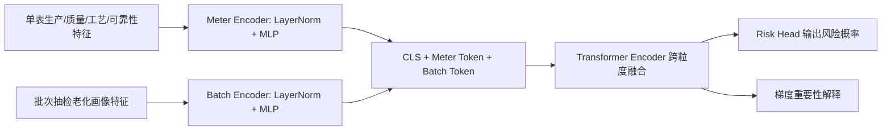

# 当前系统软件的算法与创新点梳理

## 一、系统算法总体定位

当前系统不是单一预测模型，而是一套面向智能电表全生命周期质量追溯的“多源数据融合 + 风险预测 + 异常检测 + 可解释追溯 + 实验验证”算法体系。

其核心目标是：把智能电表从来料、生产、工艺过程、抽检老化、可靠性样机试验、用电异常等多环节数据打通，形成可训练、可解释、可落地的软件系统，用于出厂前质量风险预测、异常电表识别和质量根因追溯。

可以概括为：

> 面向智能电表全生命周期质量追溯的多源异构数据融合与可解释风险预测方法。

## 二、当前系统已实现的主要算法模块

| 模块 | 已实现内容 | 对应代码 |
|---|---|---|
| 多源数据融合 | 将质量链路、生产追溯、电路板工艺、可靠性样机、批次抽检老化等数据融合成统一特征快照 | `app/services/data_linkage_service.py` |
| 质量风险预测 | 支持 MGQ-Former、TabNet、LightGBM 三类模型训练与预测 | `app/services/predict_service.py` |
| 深度融合模型 | 实现 MGQ-Former 多粒度质量融合 Transformer | `app/services/deep_fusion_service.py` |
| 表格深度学习基线 | 实现 TabNet，利用 sequential attention 输出特征重要度 | `app/services/tabnet_service.py` |
| 传统机器学习基线 | LightGBM、XGBoost、RandomForest、规则模型等 | `app/services/ablation_service.py` |
| 用电异常检测 | 基于阈值、Z-score、时序趋势和多维规则识别异常电表 | `app/services/anomaly_service.py` |
| 可解释追溯 | 基于 SHAP / 规则回退输出特征贡献、瀑布图和文字追溯报告 | `app/services/shap_service.py` |
| 消融实验 | 支持多特征组 × 多模型的交叉验证对比 | `app/services/ablation_service.py` |
| 可靠性样机接入 | 解析生产数据和试验后数据，形成可靠性样机画像特征 | `app/services/reliability_sample_service.py` |

## 三、数据融合算法设计

### 1. 多源异构数据统一建模

系统将不同来源的数据统一映射到质量风险预测特征空间。目前融合的数据包括：

- 来料与基础器件数据：晶振 ppm、互感器误差、时钟精度、出厂故障标记。
- 老化试验数据：初始误差、末期误差、误差退化率、时钟漂移、日计时误差、误差变差、一致性、电量平衡、尖峰平谷比例、RS485 异常。
- 生产追溯数据：CCD 重检、功能重检、复检、总重试次数、SMT AOI 缺陷、波峰焊 AOI 缺陷、维修情况、漏电流、生产质量风险分。
- 电路板工艺过程画像：SMT 压力/位移、贴片精度 CPK、回流焊温区跨度、传送速度、在线测试电流、波峰焊预热温区、锡炉温度、波峰高度差等。
- 可靠性样机数据：可靠性样机生产误差、试验后误差、试验前后偏移、日计时误差、可靠性风险分。
- 批次抽检老化画像：抽检样本数、高风险率、均值误差、最大误差、误差标准差、平均日误差、最大时钟偏差、通信异常率等。

### 2. 特征快照机制

系统通过 `QualityFeatureSnapshot` 生成可复现的训练样本快照。每条快照不仅包含特征值，还记录：

- `meter_no`
- `barcode`
- `normalized_barcode`
- `order_no`
- `batch_key`
- `source`
- `confidence`
- `quality_label`
- `quality_reason`

这使得系统不是简单拼表，而是保留了数据来源和链路可信度。

### 3. 抽检老化数据的正确处理

系统已区分“单表一一对应数据”和“批次抽检数据”。

老化试验并不是每块表都做，而是每批出厂表抽检几块。因此系统不强行把抽检表与生产条码一一对应，而是将其建模为批次级质量证据，即 `BatchQualityProfile`。

这点是论文中很重要的工程合理性：

> 抽检老化数据不是单表标签，而是批次质量稳定性的弱监督证据。

该处理避免了错误关联，也提高了方法在真实企业场景中的可信度。

## 四、核心预测模型：MGQ-Former

### 1. 模型名称

MGQ-Former：Multi-Granularity Quality Fusion Transformer  
中文可写为：多粒度质量融合 Transformer。

### 2. 模型输入

模型采用两个粒度的输入：

| 输入 token | 含义 |
|---|---|
| Meter Token | 单表级特征，包括来料、生产追溯、质量链路、工艺过程、可靠性样机画像等特征 |
| Batch Token | 批次级抽检老化质量画像，用于描述该批次整体稳定性 |

### 3. 模型结构

当前系统实现的是轻量化 Transformer 融合结构：

### 4. 模型特点

- 使用单表级特征和批次级特征两个 token，解决生产数据与抽检质量数据粒度不一致的问题。
- 使用 Transformer Encoder 学习单表证据与批次证据之间的非线性交互。
- 使用轻量化结构，适合本地部署和小样本实验。
- 输出风险概率、风险等级、特征重要性和模型结构信息。
- 当 MGQ-Former 训练失败时，系统可降级到 LightGBM，保证工程可用性。

### 5. 论文中可表达的创新点

可以写为：

> 针对智能电表质量数据中“单表生产记录”和“批次抽检老化记录”粒度不一致的问题，提出一种多粒度质量融合 Transformer 模型 MGQ-Former。该模型分别编码单表级质量特征与批次级抽检画像特征，并通过 Transformer 融合机制学习不同粒度质量证据之间的交互关系，从而实现出厂前质量风险预测。

## 五、TabNet 表格深度学习模型

系统同时实现了 TabNet 作为深度学习基线。

TabNet 的作用主要有两个：

1. 回应“不能只用传统机器学习”的专家质疑。
2. 提供内置注意力机制，用于样本级特征选择和解释。

当前实现包括：

- MinMaxScaler 特征归一化。
- SMOTE 类别不平衡处理。
- 5 折交叉验证。
- AUC、F1、Precision、Recall、Accuracy 指标。
- 训练损失曲线。
- Sequential Attention 特征重要度。
- attention masks 可视化数据。

论文中 TabNet 不一定作为最终主模型，但可以作为深度学习对比模型和可解释性补充。

## 六、LightGBM 与传统机器学习基线

系统保留 LightGBM 作为经典梯度提升基线，并在消融实验中还支持：

- 规则模型
- Random Forest
- XGBoost
- LightGBM
- TabNet

LightGBM 的作用：

- 作为小样本工业数据的强基线。
- 作为 MGQ-Former / TabNet 失败时的工程降级模型。
- 支持 SHAP TreeExplainer 做根因解释。

这部分适合在论文实验章节中作为对照基线。

## 七、用电异常与窃电嫌疑检测算法

系统中的用电异常检测不是主创新点，但可以作为应用扩展模块。

当前检测维度包括：

| 异常类型 | 判断依据 |
|---|---|
| 基本误差异常 | 末期误差超过阈值，或 Z-score 统计异常 |
| 时钟异常 | 全周期最大时钟偏差超过阈值，或统计异常 |
| 日计时异常 | 日误差超过阈值，或统计异常 |
| 电量比例异常 | 正反向电量比低于阈值 |
| 电量结构异常 | 尖峰平谷比例异常 |
| 稳定性异常 | 误差变差超限 |
| 通信异常 | RS485 异常次数大于 0 |

当前系统还支持单表趋势分析，包括：

- 误差时间序列
- 时钟偏差序列
- 日计时误差序列
- 电量累计序列
- 电量增量
- 正反向电量平衡
- 尖峰平谷比例
- 误差退化斜率
- 异常时间点定位

论文中建议将其定位为辅助模块：

> 用电异常与窃电嫌疑检测作为智能电表质量追溯系统的应用扩展，用于展示模型在运行侧异常识别中的迁移价值，但论文主体仍聚焦生产质量追溯与出厂风险预测。

## 八、可解释性与根因追溯

系统实现了两类解释机制。

### 1. SHAP 解释

当使用 LightGBM 等树模型时，系统调用 SHAP TreeExplainer，输出：

- 单表风险概率。
- 特征贡献值。
- 全局特征重要度。
- ECharts 瀑布图数据。
- 自动生成文字根因追溯报告。

### 2. 深度模型梯度重要性

MGQ-Former 使用梯度显著性方法计算：

- 单表级特征贡献。
- 批次级特征贡献。
- meter/batch 不同粒度证据的重要性。

### 3. 规则回退解释

当模型不可用或 SHAP 不适用时，系统会退回到规则解释，保证页面和业务流程不中断。

论文中可强调：

> 系统不仅输出风险概率，还输出风险来源、关键特征贡献和追溯建议，使预测结果能够被质检人员、工艺工程师和导师评审理解。

## 九、消融实验设计

系统已实现可运行的消融实验框架。

### 1. 特征组

| 特征组 | 含义 |
|---|---|
| Group-A | 来料特征 |
| Group-B | 来料 + 老化试验 |
| Group-C | 全特征，包含来料、老化、追溯、生产过程画像、可靠性样机画像 |
| Group-D | 仅生产过程特征 |

### 2. 模型组

| 模型 | 作用 |
|---|---|
| 规则模型 | 最低基线 |
| Random Forest | 传统集成基线 |
| XGBoost | 梯度提升基线 |
| LightGBM | 强机器学习基线 |
| TabNet | 深度学习基线 |

### 3. 指标

系统支持 5 折交叉验证，并输出：

- AUC-ROC
- F1
- Precision
- Recall
- Accuracy
- mean ± std

### 4. 论文中的实验逻辑

消融实验可用于证明：

- 生产过程特征是否带来增量贡献。
- 老化试验数据是否提升风险预测性能。
- 可靠性样机画像是否提升模型稳定性。
- 全生命周期多源融合是否优于单一阶段数据。
- 深度学习模型是否优于传统机器学习基线。

## 十、系统当前可提炼的核心创新点

### 创新点 1：面向智能电表全生命周期的多源异构质量数据融合框架

系统将来料、生产、工艺过程、质量链路、老化试验、可靠性样机、用电异常等多源数据统一到质量特征快照中，并保留数据来源、关联置信度和批次信息。

该创新点强调的是“数据链路打通”和“工程可追溯”。

### 创新点 2：考虑抽检机制的批次级质量画像建模方法

针对老化试验并非每块电表都做、而是按批次抽检的真实业务特点，系统没有强行建立错误的一一对应关系，而是构建批次级 `BatchQualityProfile`。

该创新点非常适合论文答辩，因为它体现了对真实工业数据机制的理解。

### 创新点 3：多粒度质量融合 Transformer 模型 MGQ-Former

提出单表级 Meter Token 与批次级 Batch Token 的双粒度建模方式，通过 Transformer 融合不同粒度的质量证据，实现出厂前风险预测。

该创新点是论文中最适合作为“算法创新”的部分。

### 创新点 4：面向质检场景的可解释风险预测与根因追溯机制

系统结合 SHAP、TabNet attention、MGQ-Former 梯度重要性和规则解释，输出可视化特征贡献和文字追溯建议。

该创新点解决的是模型在企业质检场景中的可信使用问题。

### 创新点 5：从软件系统到实验验证的一体化闭环

系统不仅有算法，还实现了：

- 数据录入
- Excel 导入
- 数据管理
- 模型训练
- 预测
- 异常检测
- 可解释追溯
- 消融实验
- 模型版本管理

这使论文不只是模型论文，也可以作为专业硕士“工程系统 + 算法研究”的完整成果。

## 十一、论文中建议的创新点表述

建议论文摘要或绪论中这样写：

> 本文面向智能电表生产质量追溯与出厂风险预警问题，构建了一套覆盖来料、生产过程、老化试验、可靠性样机和运行侧异常信息的多源质量数据融合框架。针对工业现场中单表生产记录与批次抽检老化数据粒度不一致的问题，提出多粒度质量融合 Transformer 模型 MGQ-Former，将单表级质量特征和批次级抽检质量画像分别编码为质量 token，并通过 Transformer 融合机制学习跨粒度质量证据之间的交互关系。进一步结合 SHAP、注意力权重和梯度显著性方法，实现面向质检人员的可解释风险预测与质量根因追溯。实验部分通过多特征组、多模型消融对比验证了生产过程特征、批次抽检画像和深度融合模型对风险预测性能的增益。

## 十二、建议在论文中弱化或谨慎表述的部分

以下内容建议作为系统功能或辅助实验，不宜作为第一创新点：

- 用电异常与窃电嫌疑检测：可以作为应用扩展，但不要抢占主线。
- DQN 在线学习：代码中有接口，但如果实验不足，不建议作为主要创新。
- TabNet：更适合作为深度学习基线，不建议说成本文原创算法。
- SHAP：是成熟解释方法，创新不在 SHAP 本身，而在“质量链路场景中的解释报告生成与根因追溯闭环”。

## 十三、最推荐的论文主线

建议最终论文主线定为：

> 面向智能电表全生命周期质量追溯的多源数据融合与多粒度可解释风险预测方法研究。

章节展开可围绕：

1. 数据链路与特征工程：解决多源异构、粒度不一致、抽检数据弱对应问题。
2. MGQ-Former 算法：解决单表级与批次级质量证据融合问题。
3. 可解释风险追溯：解决模型预测结果难以被工程人员采信的问题。
4. 系统实现与验证：证明方法可落地到企业现场数据录入、预测和追溯流程。

