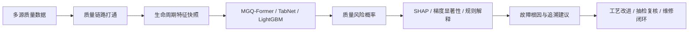
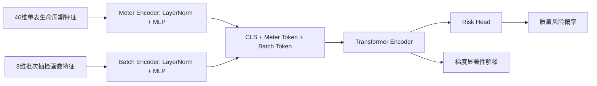
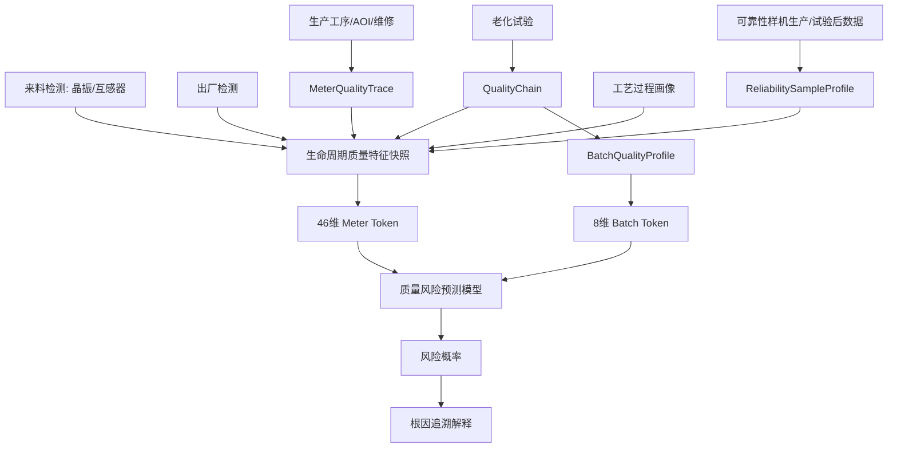

# 电表生命周期质量预测与故障溯源算法点梳理

## 一、两个算法点的总体关系

当前系统中最适合作为大论文主线的两个算法点是：

| 算法点 | 回答的问题 | 论文定位 |
|---|---|---|
| 电表生命周期质量风险预测 | 哪块表、哪批表存在较高质量风险？ | 主算法点，体现多源数据融合与深度学习建模 |
| 故障溯源与根因追溯 | 为什么它有风险？风险来自哪个生产、检测或可靠性环节？ | 解释性算法点，体现工程可落地和质量闭环 |

二者不是割裂的两个功能，而是一条完整质量智能分析链路：



一句话概括：

> 生命周期质量预测负责“发现风险”，故障溯源负责“解释风险”，两者共同构成面向智能电表全生命周期质量追溯的可解释风险预测方法。

---

## 二、算法点一：电表生命周期质量风险预测

### 1. 研究问题定义

电表生命周期质量风险预测的目标是：在电表出厂前或质量复核阶段，融合来料、生产、工艺、出厂、老化、可靠性样机等多源数据，预测电表潜在质量风险概率，并给出风险等级。

该问题不是单纯的分类问题，而具有几个典型工业特征：

- 数据来源多，字段格式不统一。
- 单表数据和批次抽检数据粒度不一致。
- 真实故障样本少，类别存在不平衡。
- 生产条码、样机编号、老化样本编号之间并非完全一一对应。
- 模型结果必须可解释，否则难以被质检人员和工程师采用。

因此，论文中建议将其定义为：

> 面向智能电表全生命周期质量链路的多源异构数据融合与小样本风险预测问题。

### 2. 当前系统使用的数据

| 数据来源 | 数据表或模块 | 当前作用 | 是否进入算法 |
|---|---|---|---|
| 晶振检测数据 | `crystal_data` | 描述关键元器件频偏质量 | 已进入 |
| 互感器检测数据 | `ct_data` | 描述计量核心器件误差 | 已进入 |
| 出厂检测数据 | `factory_test` | 描述出厂阶段时钟、故障、检测状态 | 已进入 |
| 1000h 老化试验数据 | `aging_test`、`quality_chain` | 构建误差退化、时钟漂移、通信异常等质量链路特征 | 已进入 |
| 批次抽检老化画像 | `batch_quality_profile` | 构建批次级抽检质量证据 | 已进入 MGQ-Former |
| 生产工序检测数据 | `production_inspection` | 描述 CCD、功能测试、复检、漏电流等过程异常 | 已进入，但样本较少 |
| AOI 缺陷数据 | `aoi_defect` | 描述 SMT、波峰焊等缺陷情况 | 已进入，但样本较少 |
| 维修记录 | `repair_record` | 描述故障名称、故障原因、维修工序 | 已进入溯源分析，但样本较少 |
| 单表生产追溯汇总 | `meter_quality_trace` | 形成生产过程质量风险分 | 已进入 |
| 电路板工艺过程画像 | `production_process_profile` | 描述 SMT、回流焊、在线测试、波峰焊等工艺状态 | 已进入，作为工艺画像 |
| 可靠性样机生产数据 | `reliability_sample_production_record` | 描述可靠性样机试验前误差分布 | 已进入画像 |
| 可靠性样机试验后数据 | `reliability_sample_after_record` | 描述试验后误差、偏移、日计时误差 | 已进入画像 |
| 可靠性样机聚合画像 | `reliability_sample_profile` | 构建可靠性风险先验证据 | 已进入 |
| 条码身份映射 | `meter_identity` | 连接生产条码、表号、批次 | 已进入，但映射数量不足 |

当前系统中可用于训练的主特征矩阵约为：

| 内容 | 规模 |
|---|---:|
| 最终质量特征快照 `quality_feature_snapshot` | 232 条 |
| 单表生命周期特征维度 | 46 维 |
| 批次抽检画像特征维度 | 8 维 |
| 标签 `quality_label` | 232 条 |
| 正样本数量 | 约 150 条 |

说明：这里的样本规模适合做系统演示、方法验证和专业硕士论文原型实验，但如果要支撑更强的 SCI 级结论，仍需要补充更多真实批次和长期运行数据。

### 3. 特征链路设计

当前系统将多源数据融合为两类模型输入：单表级特征和批次级特征。

#### 3.1 单表级生命周期特征，46 维

单表级特征主要进入 LightGBM、TabNet 和 MGQ-Former 的 Meter Token。

| 特征组 | 主要字段 | 含义 |
|---|---|---|
| 来料与出厂特征 | `crystal_ppm`、`ct_ratio_err`、`clock_accuracy_sd`、`factory_fault` | 描述核心元器件和出厂检测质量 |
| 老化退化特征 | `initial_error_max`、`final_error_max`、`error_degradation_rate` | 描述误差从初始到末期的变化 |
| 时钟与日计时特征 | `clock_drift_rate`、`clock_daily_error_max` | 描述时钟稳定性 |
| 误差稳定性特征 | `error_variability_max`、`error_consistency_max` | 描述老化过程中误差波动 |
| 电量结构特征 | `energy_balance_ratio`、`energy_peak_ratio` | 描述正反向、尖峰平谷等电量结构 |
| 通信异常特征 | `rs485_total_errors` | 描述 RS485 通信异常 |
| 生产追溯特征 | `prod_ccd_retry`、`prod_func_retry`、`prod_reverify_retry`、`prod_total_retry`、`prod_smt_aoi_defect`、`prod_wave_aoi_defect`、`prod_repaired`、`prod_repair_count`、`prod_leak_current_max`、`prod_quality_risk_score` | 描述生产过程中的异常痕迹 |
| 工艺过程画像 | SMT、回流焊、在线测试、波峰焊相关 10 维参数 | 描述批次或文件对应的工艺背景 |
| 可靠性样机画像 | 试验前误差、试验后误差、偏移量、日计时误差、可靠性风险分等 12 维 | 描述可靠性样机层面的质量先验证据 |

#### 3.2 批次级抽检画像特征，8 维

由于老化试验不是每块表都做，而是每批表中抽检若干样机，因此系统没有把老化样机强行映射为每块生产表的标签，而是构建批次级质量画像：

| 批次画像特征 | 含义 |
|---|---|
| 抽检样本数 | 该批次参与老化或抽检的样本规模 |
| 高风险率 | 抽检样本中高风险样本占比 |
| 平均末期误差 | 批次整体计量误差水平 |
| 最大末期误差 | 批次中最严重误差 |
| 误差标准差 | 批次内部一致性 |
| 平均日计时误差 | 批次时钟稳定性 |
| 最大时钟偏差 | 时钟异常上限 |
| 通信异常率 | RS485 等通信异常比例 |

该处理是论文中非常重要的工程合理性：

> 抽检老化数据不能被简单视为单表标签，而应作为批次级弱监督质量证据参与模型融合。

### 4. 当前模型算法

#### 4.1 MGQ-Former：多粒度质量融合 Transformer

MGQ-Former 是当前系统中最适合作为论文核心算法的模型。

模型输入分为两个 token：

| Token | 输入 | 含义 |
|---|---|---|
| Meter Token | 46 维单表生命周期特征 | 描述单块电表的来料、生产、出厂、老化、工艺、可靠性画像 |
| Batch Token | 8 维批次抽检画像 | 描述该批次抽检老化稳定性 |

模型结构可以表述为：



可写成公式：

```text
h_m = Encoder_m(x_m)
h_b = Encoder_b(x_b)
Z = [CLS, h_m, h_b]
H = TransformerEncoder(Z)
p = Sigmoid(MLP(H_CLS))
```

其中：

- `x_m` 表示 46 维单表生命周期质量特征。
- `x_b` 表示 8 维批次抽检质量画像。
- `p` 表示质量风险概率。

论文创新表达：

> 针对智能电表质量数据中单表生产记录与批次抽检老化记录粒度不一致的问题，提出多粒度质量融合 Transformer 模型 MGQ-Former，将单表级质量证据与批次级抽检证据分别编码为质量 token，并通过 Transformer 融合机制学习跨粒度质量证据之间的非线性交互关系。

#### 4.2 TabNet：表格深度学习基线

TabNet 在系统中主要作为深度学习对照模型，用于回应“不能只用传统机器学习”的质疑。

它的作用包括：

- 对 46 维表格特征进行深度建模。
- 使用 sequential attention 选择关键特征。
- 输出 attention masks，辅助解释样本预测依据。
- 与 LightGBM、MGQ-Former 对比，证明深度表格模型在该问题上的适用性。

论文中建议把 TabNet 定位为：

> 深度表格学习基线模型，而不是本文原创算法。

#### 4.3 LightGBM：强机器学习基线与解释模型

LightGBM 在当前系统中仍然非常重要，不建议删除。

它的作用包括：

- 作为小样本工业数据下的强基线。
- 作为 MGQ-Former 训练失败或数据不足时的工程降级模型。
- 支持 SHAP TreeExplainer，用于故障溯源解释。
- 用于对比传统机器学习和深度融合模型的性能差异。

论文中可以这样定位：

> LightGBM 不是本文的主要创新模型，而是用于对比验证和可解释分析的工业基线模型。

#### 4.4 规则模型、RandomForest、XGBoost

这些模型主要用于消融实验和基线对比。

可用于回答以下问题：

- 多源特征是否优于单一阶段特征？
- 生产过程特征是否带来增益？
- 批次抽检画像是否带来增益？
- 深度模型是否优于传统机器学习模型？
- 可解释基线与深度融合模型是否具有一致的风险判断方向？

### 5. 输出结果

生命周期质量风险预测模块输出：

| 输出 | 含义 |
|---|---|
| 风险概率 | 电表潜在质量风险分数 |
| 风险等级 | 正常、关注、高风险等 |
| 预测标签 | 模型判定结果 |
| 关键风险因子 | 影响预测的主要特征 |
| 批次风险证据 | 抽检老化画像对风险的贡献 |
| 模型版本 | 便于追踪模型训练来源 |

---

## 三、算法点二：故障溯源与根因追溯

### 1. 研究问题定义

故障溯源的目标是：在模型给出高风险判断后，进一步解释风险来自哪个环节、哪些特征或哪些工序。

它回答的问题包括：

- 风险是由来料问题引起的吗？
- 是否与互感器误差、晶振频偏或时钟漂移有关？
- 是否与老化过程中误差持续退化有关？
- 是否与 CCD、功能测试、复检、AOI、维修记录有关？
- 是否与 RS485 通信异常、日计时误差或电量结构异常有关？
- 是否属于批次性风险，而不是单表孤立问题？

### 2. 故障溯源使用的数据

| 数据类别 | 使用方式 |
|---|---|
| 预测模型输入特征 | 用于计算特征贡献和局部解释 |
| `quality_chain` | 用于追踪老化误差、时钟漂移、通信异常 |
| `meter_quality_trace` | 用于追踪生产工序异常和质量风险分 |
| `repair_record` | 用于统计故障名称、故障原因、维修工序 |
| `aoi_defect` | 用于定位 SMT、波峰焊等缺陷 |
| `production_inspection` | 用于分析 CCD、功能测试、复检、漏电流等异常 |
| `batch_quality_profile` | 用于判断批次级抽检风险 |
| `reliability_sample_profile` | 用于提供可靠性样机试验前后变化证据 |
| 异常检测趋势数据 | 用于辅助定位误差、时钟、电量、通信异常时间点 |

### 3. 当前系统中的溯源算法

#### 3.1 SHAP 特征贡献解释

系统在 `shap_service.py` 中实现了单表解释逻辑。

当使用 LightGBM 等树模型时，系统调用 SHAP TreeExplainer 输出：

- 单表风险概率。
- 单表特征贡献值。
- 全局特征重要性。
- 瀑布图数据。
- 自动生成的文字根因报告。

典型根因解释特征包括：

| 特征 | 可能解释 |
|---|---|
| `crystal_ppm` | 晶振频偏较大，可能影响时钟稳定性 |
| `ct_ratio_err` | 互感器误差偏大，可能影响计量准确性 |
| `factory_fault` | 出厂检测阶段已有异常标记 |
| `final_error_max` | 老化末期误差偏大 |
| `clock_drift_rate` | 时钟漂移风险较高 |
| `clock_daily_error_max` | 日计时误差异常 |
| `rs485_total_errors` | 通信异常次数偏多 |
| `prod_quality_risk_score` | 生产过程质量风险分偏高 |
| `prod_repair_count` | 维修次数较多 |

论文中应注意：

> SHAP 本身不是本文原创方法，创新点在于将 SHAP 与智能电表质量链路数据结合，形成面向质检场景的根因追溯报告。

#### 3.2 MGQ-Former 梯度显著性解释

对于 MGQ-Former，系统使用梯度显著性方法分析输入特征对风险输出的影响。

它可解释两类贡献：

- Meter Token 中单表生命周期特征的贡献。
- Batch Token 中批次抽检画像特征的贡献。

这部分适合写成：

> 针对深度融合模型可解释性不足的问题，本文引入基于梯度显著性的特征贡献分析方法，从单表证据和批次证据两个粒度解释风险来源。

#### 3.3 规则回退解释

当模型不可用、SHAP 不适用或样本信息不足时，系统使用规则解释兜底。

规则解释的作用是：

- 保证系统页面和业务流程不中断。
- 保证质检人员仍能看到可理解的风险依据。
- 对小样本或模型未训练场景更稳定。

典型规则包括：

- 晶振频偏超过阈值。
- 互感器误差超过阈值。
- 老化末期误差超过阈值。
- 时钟漂移超过阈值。
- RS485 异常次数大于 0。
- 出厂故障标记存在。
- 生产过程重测或维修次数偏多。

#### 3.4 生产维修统计分析

系统在 `production_etl_service.py` 中对生产追溯数据进行汇总，形成 `MeterQualityTrace`。

系统会聚合：

- CCD 检测失败或重测。
- 功能测试失败或重测。
- 复检失败。
- SMT AOI 缺陷。
- 波峰焊 AOI 缺陷。
- 维修记录。
- 故障工序。
- 故障名称。
- 漏电流最大值。
- 综合生产质量风险分。

同时，系统可生成：

| 分析 | 含义 |
|---|---|
| 故障名称分布 | 哪些故障最常见 |
| 原因名称分布 | 哪些原因最集中 |
| 工序分布 | 哪些工序更容易产生异常 |
| 工序-故障映射 | 某工序最常出现哪些故障 |

这部分是故障溯源的重要工程依据。

#### 3.5 工序缺陷传播分析

系统还支持分析早期工序异常是否会传播到后续工序。

逻辑可以描述为：

```text
前序工序失败或重测 -> 后续工序失败或复检 -> 计算传播概率 -> 输出风险传播路径
```

论文中可写成：

> 基于生产工序检测记录，构建工序间缺陷传播关系，分析前序异常对后续测试失败或维修事件的影响，从而辅助定位关键质量控制点。

#### 3.6 异常趋势辅助定位

`anomaly_service.py` 中实现了基于阈值和 Z-score 的异常检测，可辅助故障溯源。

它检测的内容包括：

- 误差异常。
- 时钟异常。
- 日计时异常。
- 正反向电量比例异常。
- 尖峰平谷电量结构异常。
- 稳定性异常。
- RS485 通信异常。

在论文中，这部分不建议作为主创新，而应作为：

> 运行侧或老化侧趋势异常定位工具，用于辅助根因分析和案例展示。

### 4. 故障溯源输出形式

系统可输出以下内容：

| 输出 | 含义 |
|---|---|
| 单表风险解释报告 | 说明该表为什么被判为高风险 |
| 特征贡献排序 | 展示最重要的风险因子 |
| SHAP 瀑布图 | 展示各特征如何推高或降低风险 |
| 全局特征重要性 | 展示总体上哪些因素最影响质量风险 |
| 生产工序异常摘要 | 展示 CCD、功能测试、AOI、维修等异常 |
| 故障原因统计 | 展示故障名称、原因、工序分布 |
| 缺陷传播路径 | 展示前后工序之间的风险传导 |
| 人工复核建议 | 给出工程师下一步检查方向 |

---

## 四、两个算法点如何形成完整论文链路

### 1. 数据链路



### 2. 算法链路

| 阶段 | 算法或方法 | 作用 |
|---|---|---|
| 数据清洗 | 条码标准化、字段映射、缺失处理 | 打通 Excel、数据库和人工录入数据 |
| 特征构建 | 生命周期质量特征快照 | 将多源数据转为统一模型输入 |
| 批次建模 | 抽检老化画像 | 解决老化试验不是每表必做的问题 |
| 风险预测 | MGQ-Former | 核心深度融合模型 |
| 对照实验 | LightGBM、XGBoost、RandomForest、TabNet | 验证模型有效性 |
| 可解释分析 | SHAP、梯度显著性、attention masks | 分析风险来源 |
| 故障溯源 | 维修统计、工序缺陷传播、规则解释 | 定位生产和质量根因 |
| 应用闭环 | 人工复核、工艺改进、抽检策略优化 | 支撑企业落地 |

### 3. 论文中的章节安排建议

这两个算法点建议放在论文的第 4 章和第 5 章：

| 章节 | 内容 |
|---|---|
| 第 3 章 | 多源数据处理与生命周期质量特征构建 |
| 第 4 章 | 基于 MGQ-Former 的电表生命周期质量风险预测方法 |
| 第 5 章 | 面向质量链路的故障溯源与可解释根因分析方法 |
| 第 6 章 | 系统实现、案例分析与用电异常扩展应用 |

---

## 五、当前数据与模型的不足

### 1. 数据不足

| 问题 | 影响 | 论文中建议表述 |
|---|---|---|
| 生产追溯数据真实映射数量较少 | 难以充分证明生产过程特征的统计显著性 | 当前已建立链路，后续需扩大企业现场采集规模 |
| `meter_identity` 条码映射较少 | 单表生产数据和老化样机难以完全对应 | 采用单表特征与批次画像双粒度融合，避免错误强关联 |
| AOI 和维修样本较少 | 故障工序统计稳定性不足 | 作为工程案例和溯源机制展示，不宜过度声称泛化结论 |
| 批次画像数量少 | 批次间差异学习不足 | 当前适合验证建模思路，后续需补充多批次抽检数据 |
| 可靠性样机数据量大但桥接弱 | 难以作为单表强标签 | 建议作为可靠性先验画像，而不是单表标签 |

### 2. 模型风险

| 风险 | 说明 | 应对方式 |
|---|---|---|
| 样本量较小导致 AUC 波动 | 232 条样本下交叉验证容易受划分影响 | 使用多折交叉验证、Bootstrap 置信区间、PR-AUC |
| 类别不平衡 | 高风险和正常样本比例不均 | 使用类别权重、SMOTE 仅在训练集内处理 |
| 深度模型可能过拟合 | MGQ-Former 参数量虽轻量，但样本仍偏少 | 使用轻量模型、正则化、早停、消融实验 |
| SHAP 主要适配树模型 | 深度模型解释需另行处理 | 对 LightGBM 用 SHAP，对 MGQ-Former 用梯度显著性 |

### 3. 论文中不能过度声称的内容

建议避免以下表述：

- “已经实现所有电表全生命周期一一对应追溯。”
- “模型可直接替代人工质检。”
- “当前结果已证明对所有批次均具有稳定泛化能力。”
- “SHAP 或 TabNet 是本文原创算法。”
- “可靠性样机数据已完全映射到每块生产电表。”

建议改为：

> 当前系统已建立面向企业现场的多源质量数据融合框架，并在现有样本上验证了单表级质量特征、批次级抽检画像与可解释风险预测的可行性。对于生产追溯样本不足和跨系统条码映射不完整问题，本文采用多粒度证据融合方式降低错误关联风险，并将其作为后续企业部署中持续补充的数据闭环。

---

## 六、可作为论文创新点的表述

### 创新点 1：面向智能电表全生命周期的多源质量数据融合框架

融合来料检测、出厂检测、老化试验、生产工序、AOI 缺陷、维修记录、工艺过程画像和可靠性样机数据，构建统一的生命周期质量特征快照。

### 创新点 2：考虑抽检机制的批次级质量画像建模

针对老化试验按批次抽检而非每表必检的真实业务机制，构建批次级抽检质量画像，避免将抽检样本错误映射为单表标签。

### 创新点 3：多粒度质量融合 Transformer 模型 MGQ-Former

将单表级生命周期特征编码为 Meter Token，将批次级抽检画像编码为 Batch Token，通过 Transformer Encoder 学习不同粒度质量证据之间的交互关系，实现质量风险预测。

### 创新点 4：面向质检场景的可解释故障溯源机制

结合 SHAP、梯度显著性、规则回退、维修统计和工序缺陷传播分析，将模型风险概率分解为可理解的质量根因和工程复核建议。

### 创新点 5：算法与企业操作系统的一体化闭环

系统支持 Excel 导入、数据库管理、逐条录入、模型训练、风险预测、根因解释、异常检测和人工复核，体现专业硕士论文所需要的工程落地能力。

---

## 七、答辩时可以这样讲

如果老师问“你的两个算法点是什么”，可以回答：

> 第一个算法点是电表生命周期质量风险预测。我把来料、生产、出厂、老化、可靠性样机等多源数据融合成 46 维单表生命周期特征，同时考虑老化试验按批次抽检的业务特点，构建 8 维批次质量画像，并提出 MGQ-Former 模型，用 Meter Token 和 Batch Token 融合单表级与批次级质量证据，输出质量风险概率。

如果老师继续问“故障溯源怎么做”，可以回答：

> 第二个算法点是可解释故障溯源。模型预测高风险后，系统通过 SHAP、MGQ-Former 梯度显著性、生产维修统计、工序缺陷传播和规则回退解释，把风险概率分解到晶振、互感器、老化误差、时钟漂移、RS485 通信、生产重测、AOI 缺陷、维修记录等具体环节，最终给质检人员输出可理解的根因报告和复核建议。

如果老师质疑“数据并不是每块表都能对应”，可以回答：

> 我没有把无法可靠对应的数据强行拼接成单表标签，而是区分了单表级数据和批次级抽检数据。对于生产条码能对应的部分，进入单表生命周期特征；对于老化抽检和可靠性样机这类不能完全一一对应的数据，构建批次或样机画像作为弱质量证据。这种多粒度融合方式更符合企业真实质检流程，也避免了错误关联导致的模型污染。

---

## 八、后续最值得补强的方向

| 优先级 | 建议 | 对论文价值 |
|---|---|---|
| 高 | 补充更多批次的 `BatchQualityProfile` | 增强 MGQ-Former 批次融合说服力 |
| 高 | 增加 `meter_identity` 条码映射 | 提高生产追溯和单表预测可信度 |
| 高 | 增加 AOI、维修、复检记录 | 强化故障溯源案例和工序传播分析 |
| 中 | 增加 Bootstrap 置信区间和 PR-AUC | 降低小样本 AUC 被质疑的风险 |
| 中 | 增加 2-3 个典型单表根因案例 | 提升论文案例分析质量 |
| 中 | 增加模型消融实验图表 | 证明多源融合、批次画像、深度模型的贡献 |
| 低 | 扩展用电异常与窃电检测 | 作为系统扩展应用，不抢主线 |

---

## 九、最终建议定位

当前系统最稳妥、最有论文价值的定位是：

> 以智能电表全生命周期质量追溯为主线，以多源数据融合和 MGQ-Former 风险预测为核心算法，以 SHAP 与梯度显著性为解释工具，以生产工序、维修记录和异常趋势分析为故障溯源依据，形成可落地的企业级质量风险预测与追溯系统。

这个定位比单纯写“机器学习预测电表故障”更稳，也比单纯写“窃电检测”更贴合当前系统已有数据和专业硕士论文要求。
