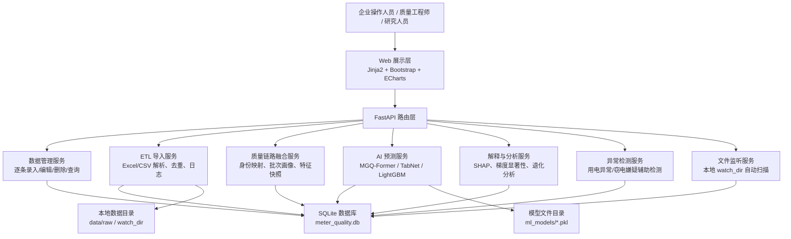
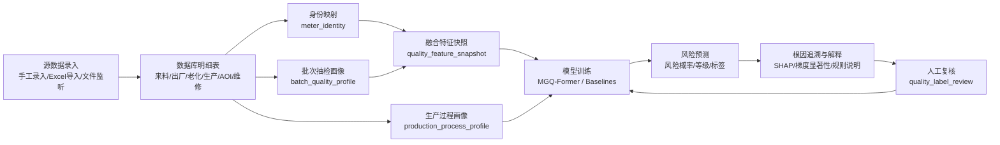
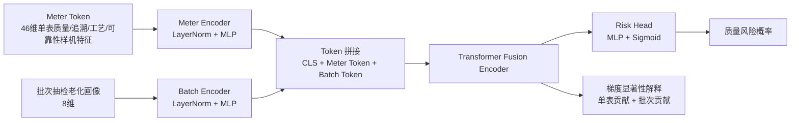
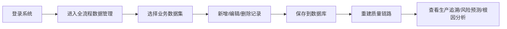

# 智能电表全生命周期质量管控系统：系统架构、功能说明与使用说明

## 1. 系统定位

本系统面向智能电表生产企业的质量追溯、风险预测、根因分析和异常检测场景，目标是把来料、出厂、老化、生产过程、AOI、维修、模型训练和人工复核等数据纳入统一数据库管理，并通过 AI 模型实现质量风险预测与可解释分析。

系统既支持 Excel/CSV 批量导入，也支持操作人员在“全流程数据管理”页面逐条录入、编辑、删除和复核数据，适合企业内部单机部署或内网部署演示。

## 2. 总体系统架构图



## 3. 技术架构

| 层级 | 技术/文件 | 说明 |
|---|---|---|
| Web 框架 | FastAPI | 后端路由、接口、SSE 训练进度推送 |
| 页面渲染 | Jinja2 Templates | 系统页面模板 |
| 前端组件 | Bootstrap、Bootstrap Icons、ECharts | 表单、布局、图表展示 |
| 数据库 | SQLite + SQLAlchemy | 单机数据库管理全流程数据 |
| AI 模型 | PyTorch、scikit-learn、LightGBM、TabNet | 风险预测、基线模型、深度融合模型 |
| 模型持久化 | joblib + `ml_models` | 保存模型版本 |
| 文件监听 | 本地目录轮询 | 监听企业导出的 Excel/CSV 文件 |

## 4. 数据库核心表

| 数据表 | 业务含义 |
|---|---|
| `crystal_data` | 晶振来料检测数据 |
| `ct_data` | 互感器来料检测数据 |
| `factory_test` | 电表出厂检测数据 |
| `aging_test` | 1000h 老化/可靠性抽检数据 |
| `quality_chain` | 单表质量链路汇总特征 |
| `production_inspection` | 生产工序检测记录 |
| `aoi_defect` | AOI 缺陷记录 |
| `repair_record` | 维修闭环记录 |
| `board_test_detail` | 单板详细测试记录 |
| `meter_quality_trace` | 单表全工序质量追溯汇总 |
| `meter_identity` | 电表编号、条码、订单、批次映射 |
| `production_process_profile` | 数字化电路板生产过程画像，存放 SMT、回流焊、在线测试、波峰焊等批次级工艺参数 |
| `batch_quality_profile` | 批次抽检老化质量画像 |
| `quality_feature_snapshot` | 模型训练用 24 维基础融合特征快照 |
| `model_version` | AI 模型版本管理 |
| `data_ingestion_log` | 文件导入与监听日志 |
| `quality_label_review` | 人工复核与增量训练标签 |

## 5. 数据流与业务闭环



## 6. AI 模型架构：MGQ-Former

系统当前主模型为 MGQ-Former，即 Multi-Granularity Quality Fusion Transformer，用于解决“单表生产质量数据、批次级电路板工艺画像、批次抽检老化数据”粒度不一致的问题。

当前模型输入口径为：`quality_feature_snapshot` 中的 24 维基础快照 + `production_process_profile` 中的 10 维生产过程画像 + `reliability_sample_profile` 中的 12 维可靠性样机画像，组成 46 维 Meter Token；再与 `batch_quality_profile` 中的 8 维 Batch Token 一起进入 Transformer 融合层。



模型特点：

- 不把老化抽检样本强行对应到每块生产电表。
- 将抽检老化样本先聚合为批次级可靠性画像。
- 将数字化电路板生产过程数据建模为批次级工艺证据，不伪装成每块表都有独立工艺实验。
- 用 Transformer 融合单表 Token 与批次 Token。
- 输出风险概率、风险等级、特征贡献解释。

## 7. 功能模块说明

### 7.1 部署向导

路径：`/setup`

功能：

- 显示数据库、数据目录、监听目录、模型目录状态。
- 提供标准 Excel 模板下载。
- 帮助操作人员完成系统初始化。

### 7.2 质量看板

路径：`/dashboard`

功能：

- 展示质量数据总体概况。
- 显示模型状态、数据规模、风险分布等 KPI。
- 用于管理人员快速了解当前系统运行情况。

### 7.3 数据导入

路径：`/import`

功能：

- 支持从 `data/raw` 批量导入 Excel 数据。
- 支持上传单个 Excel 文件并指定数据类型。
- 支持手工录入部分基础数据。
- 支持模型训练和模型版本管理。
- 默认训练模型为 MGQ-Former，TabNet 和 LightGBM 作为基线。

### 7.4 全流程数据管理

路径：`/data-management`

功能：

- 面向企业操作人员的数据库录入中心。
- 支持按数据集逐条新增、编辑、删除、查询。
- 覆盖来料、出厂、老化、生产、AOI、维修、生产过程画像、质量链路、批次画像、融合快照等数据。
- 支持一键重建质量链路，重新生成身份映射、批次画像和融合特征快照。

典型用途：

- 质检员录入某批晶振或互感器抽检结果。
- 产线操作员录入某块电表的工序检测结果。
- 维修人员补录维修现象、原因和维修时间。
- 质量工程师修正条码与批次映射关系。

### 7.5 质量风险预测

路径：`/predict`

功能：

- 支持单表风险预测。
- 支持批量风险预测。
- 显示风险概率、风险等级、模型版本。
- 支持 DQN/人工反馈接口，用于后续在线学习或复核闭环。

### 7.6 出厂故障预测

路径：`/factory-fault`

功能：

- 面向出厂检测环节预测故障风险。
- 根据晶振、互感器、时钟、通信、起动潜动等指标给出故障风险。
- 可作为出厂质检辅助判断模块。

### 7.7 根因追溯

路径：`/rootcause`

功能：

- 对高风险电表进行原因定位。
- 结合质量链路、生产过程、老化退化和模型解释结果。
- 输出关键风险因子和根因说明。

### 7.8 退化分析

路径：`/degradation`

功能：

- 分析老化试验中误差、时钟漂移、RS485 通信异常等随时间变化的趋势。
- 识别持续退化、突变退化和阈值越限。
- 支撑论文中的可靠性退化分析章节。

### 7.9 用电异常与窃电嫌疑检测

路径：`/anomaly`

功能：

- 作为运行阶段扩展应用。
- 根据误差、时钟、电量结构、通信异常等指标识别异常用电或疑似窃电。
- 当前定位为辅助告警模块，不作为论文主创新点。

### 7.10 生产追溯

路径：`/production`

功能：

- 展示单表全工序生产质量链路。
- 支持按条码、订单、结果筛选。
- 展示生产工序、AOI、维修、批次抽检画像等关联信息。
- 支持构建生产数据与质量链路之间的映射。

### 7.11 维修分析

路径：`/repair-analysis`

功能：

- 统计维修记录、故障现象、故障原因和缺陷传播路径。
- 支撑质量改进和生产工艺优化。

### 7.12 消融实验

路径：`/ablation`

功能：

- 对比不同特征组和不同模型的效果。
- 支持 Rule、RandomForest、XGBoost、LightGBM、TabNet 等基线实验。
- 用于论文中证明生产特征、老化特征、深度模型等模块的贡献。

### 7.13 本地文件扫描与人工复核

路径：`/data-review`

功能：

- 监听本地 `watch_dir` 中新增的 Excel/CSV 文件。
- 记录导入日志。
- 支持人工确认、驳回、打标。
- 与增量训练和全量重训练流程连接。

## 8. 常用接口说明

| 接口 | 方法 | 说明 |
|---|---|---|
| `/login` | GET/POST | 登录 |
| `/setup` | GET | 部署向导 |
| `/templates/download/{type}` | GET | 下载标准 Excel 模板 |
| `/data-management` | GET | 全流程数据管理页面 |
| `/data-management/api/datasets` | GET | 获取可管理数据集 |
| `/data-management/api/{dataset}` | GET/POST | 查询/新增记录 |
| `/data-management/api/{dataset}/{id}` | PUT/DELETE | 编辑/删除记录 |
| `/data-management/api/rebuild-linkage` | POST | 重建质量链路 |
| `/import/excel` | POST | 批量导入原始数据 |
| `/train/stream?model_type=mgqformer` | GET | 流式训练 MGQ-Former |
| `/models` | GET | 模型版本列表 |
| `/models/mgqformer/architecture` | GET | 获取 MGQ-Former 结构信息 |
| `/predict/single` | POST | 单表预测 |
| `/predict/batch` | POST | 批量预测 |
| `/production/trace` | GET | 生产追溯列表 |
| `/production/linkage/build` | POST | 重建生产质量链路 |
| `/retrain/full` | POST | 全量重训练 |
| `/retrain/incremental` | POST | 基于复核数据增量训练 |

## 9. 使用说明

### 9.1 启动系统

在项目根目录运行：

```powershell
.\venv\Scripts\python.exe -X utf8 -m uvicorn main:app --host 0.0.0.0 --port 8090
```

访问：

```text
http://127.0.0.1:8090/setup
```

默认账号：

```text
admin
```

默认密码：

```text
admin123
```

### 9.2 初始化数据

推荐两种方式：

- 批量导入：进入“数据导入”，下载模板，填写后上传或放入 `data/raw`。
- 逐条录入：进入“全流程数据管理”，选择对应数据集，点击“新增记录”逐条录入。

### 9.3 企业操作人员日常录入流程



操作建议：

- 来料检验员维护 `crystal_data`、`ct_data`。
- 出厂质检员维护 `factory_test`。
- 可靠性工程师维护 `aging_test`。
- 产线操作员维护 `production_inspection`、`aoi_defect`。
- 维修人员维护 `repair_record`。
- 质量工程师维护 `meter_identity`、`quality_chain`、`production_process_profile`、`batch_quality_profile`。

### 9.4 训练模型

进入“数据导入”页面：

1. 确认数据库已有质量链路或融合快照数据。
2. 模型选择默认使用 `MGQ-Former（跨粒度深度融合）`。
3. 点击“开始训练”。
4. 训练完成后查看 AUC、F1、混淆矩阵和 ROC 曲线。
5. 模型版本会写入 `model_version` 表，并保存到 `ml_models` 目录。

注意：页面中的 AUC 如果来自当前训练集，应描述为“训练集表观 AUC”。论文正式实验应使用交叉验证或独立测试集。

### 9.5 单表预测

进入“质量风险预测”页面：

1. 输入或选择电表特征。
2. 点击单表预测。
3. 查看风险概率、风险等级、预测标签和模型版本。
4. 如有人工复核结果，可反馈给系统用于后续训练闭环。

### 9.6 生产追溯

进入“生产追溯”页面：

1. 可按条码、订单、通过状态、高风险状态筛选。
2. 查看单表工序检测、AOI 缺陷、维修记录、批次抽检画像。
3. 若录入数据有变动，可先在“全流程数据管理”中重建质量链路。

### 9.7 本地文件监听

进入“本地文件扫描”页面：

1. 将企业导出的 Excel/CSV 放入 `watch_dir`。
2. 系统自动扫描并记录到 `data_ingestion_log`。
3. 操作人员在页面中复核文件解析结果。
4. 确认后的数据可进入训练或重训练流程。

## 10. 论文/答辩可强调的系统创新点

- 建立了覆盖智能电表全生命周期的数据库驱动型质量数据管理体系。
- 支持批量导入与逐条录入两种企业实际使用模式。
- 将生产过程单表数据与老化抽检批次数据通过批次画像进行跨粒度融合。
- 将数字化电路板生产过程 Excel 的下半部分工艺参数接入 `production_process_profile`，作为 46 维模型输入中的 10 维工艺画像；新增 X202201001 可靠性样机生产数据与试验后数据接入 `reliability_sample_profile`，补足另外 12 维批次/样机级可靠性画像。
- 提出并实现 MGQ-Former 深度融合模型，避免将抽检老化样本错误映射到每块表。
- 构建了从数据录入、链路融合、风险预测、根因解释、人工复核到重训练的闭环系统。
- 用电异常与窃电嫌疑检测作为运行阶段扩展模块，增强系统应用边界。

## 11. 当前实现文件索引

| 文件/目录 | 作用 |
|---|---|
| `main.py` | FastAPI 应用入口与路由注册 |
| `database.py` | 数据库连接与初始化 |
| `app/models/db_models.py` | 数据库表模型 |
| `app/routers/system.py` | 登录、部署向导、模板下载 |
| `app/routers/data_import.py` | 数据导入、模型训练、模型管理 |
| `app/routers/data_management.py` | 全流程数据库 CRUD 管理 |
| `app/routers/risk_predict.py` | 风险预测接口 |
| `app/routers/production.py` | 生产追溯与维修分析接口 |
| `app/services/deep_fusion_service.py` | MGQ-Former 模型 |
| `app/services/predict_service.py` | 训练、预测、模型版本管理 |
| `app/services/data_linkage_service.py` | 身份映射、批次画像、生产过程画像融合、融合快照 |
| `app/services/etl_service.py` | 基础 Excel 数据导入与数字化电路板生产过程画像解析 |
| `app/services/production_etl_service.py` | 生产过程数据导入 |
| `app/services/anomaly_service.py` | 用电异常检测 |
| `templates/*.html` | 系统页面 |
| `ml_models/` | 模型文件 |
| `meter_quality.db` | SQLite 数据库 |
